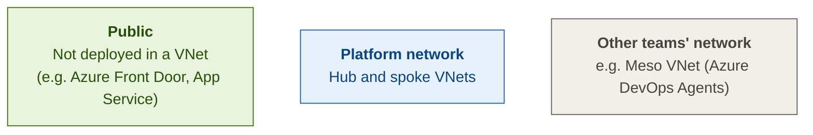

# Public Exposure of Spoke Web Applications – Option Comparison

**Context:** Our platform uses a hub-spoke topology with one spoke per customer. Each spoke hosts an Azure App Service and Azure Databricks with private endpoints in a subnet of the spoke VNet. The hub hosts Azure Firewall, and all outbound traffic from the spokes is forced through it. Spokes cannot reach each other.

**Options we evaluated:**

- **Option 1:** Azure Front Door → Private Link → private Application Gateway (hub) → App Service private endpoint (spoke)
- **Option 2:** Azure Front Door → Private Link → App Service
- **Option 3:** Public Application Gateway → App Service

**Recommendation:** We propose Option 2. We would only move to Option 1 if hub-owned inbound inspection or Application Gateway-only features become a requirement. We consider Option 3 the weakest fit for our hub-spoke design with forced tunnelling.

**Cost summary (West Europe, list prices, low traffic):** Option 2 is the cheapest at about €341 per month. Option 3 costs about €517 (€692 with DDoS IP Protection). Option 1 costs about €610 with a Standard_v2 gateway or €827 with WAF_v2. See [Cost Estimate](#cost-estimate--west-europe-front-door-and-application-gateway-only).

---

## Architecture Diagrams

All three diagrams share the same building blocks:

- Hub VNet and spoke VNet (one per customer), connected by VNet peering
- App Service as a public PaaS service with public network access disabled. It has a private endpoint and a VNet integration (delegated) subnet in the spoke.
- All outbound traffic: App Service → VNet integration → peering → Azure Firewall (hub) → internet
- Azure Front Door (Options 1 and 2) always connects through its own managed private endpoint in a Microsoft-managed network, using Private Link
- Deployments to the App Service SCM (Kudu) site come from our self-hosted Azure DevOps agents in the **Meso VNet (Azure DevOps Agents)**, through a dedicated App Service private endpoint in that VNet

### Legend

**Colours**



**Arrows**

| Arrow | Meaning |
|---|---|
| Solid grey | Inbound traffic |
| Dotted grey, labelled "Private Link" | Private Link connection |
| Dotted grey, labelled "SCM deployment" | Deployment from the Azure DevOps agents |
| Amber dashed | Outbound traffic (always through Azure Firewall) |

### Option 1: Azure Front Door → Private Link → private App Gateway (hub) → App Service PE (spoke)

```mermaid
%%{init: {"flowchart": {"nodeSpacing": 25, "rankSpacing": 30, "padding": 6, "diagramPadding": 4}, "themeVariables": {"fontSize": "12px"}}}%%
flowchart TB
    U["<br/><b>Internet users</b>"]
    AFD["<br/><b>Azure Front Door Premium</b><br/>Global WAF, CDN, DDoS"]
    MPE["<br/><b>Azure Front Door managed PE</b><br/>Microsoft-managed network"]
    APP["<img src='data:image/svg+xml;base64,PHN2ZyBpZD0iYjcwYWNmMGEtMzRiNC00YmRmLTkwMjQtNzQ5NjA0M2ZmOTE1IiB4bWxucz0iaHR0cDovL3d3dy53My5vcmcvMjAwMC9zdmciIHdpZHRoPSIxOCIgaGVpZ2h0PSIxOCIgdmlld0JveD0iMCAwIDE4IDE4Ij48ZGVmcz48cmFkaWFsR3JhZGllbnQgaWQ9ImUyY2Y4NzQ2LWM5YTgtNGVlZS04NmMyLTQ5NTE5ODNjNjAzMiIgY3g9IjEzNDI4LjgxIiBjeT0iMzUxOC44NiIgcj0iNTYuNjciIGdyYWRpZW50VHJhbnNmb3JtPSJ0cmFuc2xhdGUoLTIwMDUuMzMgLTUxOC44Mykgc2NhbGUoMC4xNSkiIGdyYWRpZW50VW5pdHM9InVzZXJTcGFjZU9uVXNlIj48c3RvcCBvZmZzZXQ9IjAuMTgiIHN0b3AtY29sb3I9IiM1ZWEwZWYiIC8+PHN0b3Agb2Zmc2V0PSIxIiBzdG9wLWNvbG9yPSIjMDA3OGQ0IiAvPjwvcmFkaWFsR3JhZGllbnQ+PGxpbmVhckdyYWRpZW50IGlkPSJiZGQyMTNkZC1kMzEzLTQ3M2MtOGZmNC0wMTMzZmQzYTkwMzMiIHgxPSI0LjQiIHkxPSIxMS40OCIgeDI9IjQuMzciIHkyPSI3LjUzIiBncmFkaWVudFVuaXRzPSJ1c2VyU3BhY2VPblVzZSI+PHN0b3Agb2Zmc2V0PSIwIiBzdG9wLWNvbG9yPSIjY2NjIiAvPjxzdG9wIG9mZnNldD0iMSIgc3RvcC1jb2xvcj0iI2ZjZmNmYyIgLz48L2xpbmVhckdyYWRpZW50PjxsaW5lYXJHcmFkaWVudCBpZD0iYWZjYzYzYzUtMzY0OS00NDc2LWE3NDItYmNiNTNhNTY5ZjNjIiB4MT0iMTAuMTMiIHkxPSIxNS40NSIgeDI9IjEwLjEzIiB5Mj0iMTEuOSIgZ3JhZGllbnRVbml0cz0idXNlclNwYWNlT25Vc2UiPjxzdG9wIG9mZnNldD0iMCIgc3RvcC1jb2xvcj0iI2NjYyIgLz48c3RvcCBvZmZzZXQ9IjEiIHN0b3AtY29sb3I9IiNmY2ZjZmMiIC8+PC9saW5lYXJHcmFkaWVudD48bGluZWFyR3JhZGllbnQgaWQ9ImJkODczZjBiLTk5NTQtNGFhNS1hM2RmLTlmNGM2NGU4NzI5ZCIgeDE9IjE0LjE4IiB5MT0iMTEuMTUiIHgyPSIxNC4xOCIgeTI9IjcuMzgiIGdyYWRpZW50VW5pdHM9InVzZXJTcGFjZU9uVXNlIj48c3RvcCBvZmZzZXQ9IjAiIHN0b3AtY29sb3I9IiNjY2MiIC8+PHN0b3Agb2Zmc2V0PSIxIiBzdG9wLWNvbG9yPSIjZmNmY2ZjIiAvPjwvbGluZWFyR3JhZGllbnQ+PC9kZWZzPjxwYXRoIGlkPSJlZTc1ZGQwNi0xYWNhLTRmNzYtOWQxMS1kMDVhMjg0MDIwYWQiIGQ9Ik0xNC4yMSwxNS43MkE4LjUsOC41LDAsMCwxLDMuNzksMi4yOGwuMDktLjA2YTguNSw4LjUsMCwwLDEsMTAuMzMsMTMuNSIgZmlsbD0idXJsKCNlMmNmODc0Ni1jOWE4LTRlZWUtODZjMi00OTUxOTgzYzYwMzIpIiAvPjxwYXRoIGQ9Ik02LjY5LDcuMjNBMTMsMTMsMCwwLDEsMTUuNiwzLjY1YTguNDcsOC40NywwLDAsMC0xLjQ5LTEuNDQsMTQuMzQsMTQuMzQsMCwwLDAtNC42OSwxLjFBMTIuNTQsMTIuNTQsMCwwLDAsNS4zNCw2LjEzLDIuNzYsMi43NiwwLDAsMSw2LjY5LDcuMjNaIiBmaWxsPSIjZmZmIiBvcGFjaXR5PSIwLjYiIC8+PHBhdGggZD0iTTIuNDgsMTAuNjVhMTcuODYsMTcuODYsMCwwLDAtLjgzLDIuNjIsNy44Miw3LjgyLDAsMCwwLC42Mi45MmMuMTguMjMuMzUuNDQuNTUuNjVBMTcuOTQsMTcuOTQsMCwwLDEsMy45LDExLjM3LDIuNzYsMi43NiwwLDAsMSwyLjQ4LDEwLjY1WiIgZmlsbD0iI2ZmZiIgb3BhY2l0eT0iMC42IiAvPjxwYXRoIGQ9Ik0zLjQ2LDYuMTFhMTIsMTIsMCwwLDEtLjY5LTIuOTQsOC4xNSw4LjE1LDAsMCwwLTEuMSwxLjQ1QTEyLjY5LDEyLjY5LDAsMCwwLDIuMjQsNywyLjY5LDIuNjksMCwwLDEsMy40Niw2LjExWiIgZmlsbD0iI2YyZjJmMiIgb3BhY2l0eT0iMC41NSIgLz48Y2lyY2xlIGN4PSI0LjM4IiBjeT0iOC42OCIgcj0iMi43MyIgZmlsbD0idXJsKCNiZGQyMTNkZC1kMzEzLTQ3M2MtOGZmNC0wMTMzZmQzYTkwMzMpIiAvPjxwYXRoIGQ9Ik04LjM2LDEzLjY3QTEuNzcsMS43NywwLDAsMSw4LjksMTIuNGExMS44OCwxMS44OCwwLDAsMS0yLjUzLTEuODYsMi43NCwyLjc0LDAsMCwxLTEuNDkuODMsMTMuMSwxMy4xLDAsMCwwLDEuNDUsMS4yOEExMi4xMiwxMi4xMiwwLDAsMCw4LjM4LDEzLjksMS43OSwxLjc5LDAsMCwxLDguMzYsMTMuNjdaIiBmaWxsPSIjZjJmMmYyIiBvcGFjaXR5PSIwLjU1IiAvPjxwYXRoIGQ9Ik0xNC42NiwxMy44OGExMiwxMiwwLDAsMS0yLjc2LS4zMi40MS40MSwwLDAsMSwwLC4xMSwxLjc1LDEuNzUsMCwwLDEtLjUxLDEuMjQsMTMuNjksMTMuNjksMCwwLDAsMy40Mi4yNEE4LjIxLDguMjEsMCwwLDAsMTYsMTMuODEsMTEuNSwxMS41LDAsMCwxLDE0LjY2LDEzLjg4WiIgZmlsbD0iI2YyZjJmMiIgb3BhY2l0eT0iMC41NSIgLz48Y2lyY2xlIGN4PSIxMC4xMyIgY3k9IjEzLjY3IiByPSIxLjc4IiBmaWxsPSJ1cmwoI2FmY2M2M2M1LTM2NDktNDQ3Ni1hNzQyLWJjYjUzYTU2OWYzYykiIC8+PHBhdGggZD0iTTEyLjMyLDguOTNhMS44MywxLjgzLDAsMCwxLC42MS0xQTI1LjUsMjUuNSwwLDAsMSw4LjQ3LDMuNzlhMTYuOTEsMTYuOTEsMCwwLDEtMi0yLjkyLDcuNjQsNy42NCwwLDAsMC0xLjA5LjQyQTE4LjE0LDE4LjE0LDAsMCwwLDcuNTMsNC40NywyNi40NCwyNi40NCwwLDAsMCwxMi4zMiw4LjkzWiIgZmlsbD0iI2YyZjJmMiIgb3BhY2l0eT0iMC43IiAvPjxjaXJjbGUgY3g9IjE0LjE4IiBjeT0iOS4yNyIgcj0iMS44OSIgZmlsbD0idXJsKCNiZDg3M2YwYi05OTU0LTRhYTUtYTNkZi05ZjRjNjRlODcyOWQpIiAvPjxwYXRoIGQ9Ik0xNy4zNSwxMC41NCwxNywxMC4zN2wwLDAtLjMtLjE2LS4wNiwwTDE2LjM4LDEwbC0uMDcsMEwxNiw5LjhhMS43NiwxLjc2LDAsMCwxLS42NC45MmMuMTIuMDguMjUuMTUuMzguMjJsLjA4LjA1LjM1LjE5LDAsMCwuODYuNDVoMGE4LjYzLDguNjMsMCwwLDAsLjI5LTEuMTFaIiBmaWxsPSIjZjJmMmYyIiBvcGFjaXR5PSIwLjU1IiAvPjxjaXJjbGUgY3g9IjQuMzgiIGN5PSI4LjY4IiByPSIyLjczIiBmaWxsPSJ1cmwoI2JkZDIxM2RkLWQzMTMtNDczYy04ZmY0LTAxMzNmZDNhOTAzMykiIC8+PGNpcmNsZSBjeD0iMTAuMTMiIGN5PSIxMy42NyIgcj0iMS43OCIgZmlsbD0idXJsKCNhZmNjNjNjNS0zNjQ5LTQ0NzYtYTc0Mi1iY2I1M2E1NjlmM2MpIiAvPjwvc3ZnPg==' width='18' height='18'/><br/><b>App Service</b><br/>Public PaaS, access disabled"]
    NET["Internet (egress)"]
    subgraph HUB["Hub VNet"]
        PLS["<br/><b>Private Link service</b><br/>App GW PL configuration"]
        AGW["<img src='data:image/svg+xml;base64,PHN2ZyBpZD0iYWNhYzVhMzQtYTAzMi00OWY5LTkzOTctMzdmNGYxYjRhZTlhIiB4bWxucz0iaHR0cDovL3d3dy53My5vcmcvMjAwMC9zdmciIHdpZHRoPSIxOCIgaGVpZ2h0PSIxOCIgdmlld0JveD0iMCAwIDE4IDE4Ij48ZGVmcz48bGluZWFyR3JhZGllbnQgaWQ9ImY2ZDUzOTliLWE1Y2ItNGMwOS05NmNjLTllM2JiMWFmMjM4NiIgeDE9IjkiIHkxPSIxOS4yNSIgeDI9IjkiIHkyPSItMC40NiIgZ3JhZGllbnRUcmFuc2Zvcm09InRyYW5zbGF0ZSg5IC0zLjczKSByb3RhdGUoNDUpIiBncmFkaWVudFVuaXRzPSJ1c2VyU3BhY2VPblVzZSI+PHN0b3Agb2Zmc2V0PSIwIiBzdG9wLWNvbG9yPSIjNWU5NjI0IiAvPjxzdG9wIG9mZnNldD0iMC41NSIgc3RvcC1jb2xvcj0iIzZkYWQyYSIgLz48c3RvcCBvZmZzZXQ9IjEiIHN0b3AtY29sb3I9IiM3NmJjMmQiIC8+PC9saW5lYXJHcmFkaWVudD48bGluZWFyR3JhZGllbnQgaWQ9ImE0MzI0MmEyLTRkOTUtNGY2ZC04ODcwLTI3MDJjZWI2YWViYyIgeDE9IjcuNTQiIHkxPSI2LjQ0IiB4Mj0iNy41MyIgeTI9IjUuMTgiIGdyYWRpZW50VW5pdHM9InVzZXJTcGFjZU9uVXNlIj48c3RvcCBvZmZzZXQ9IjAiIHN0b3AtY29sb3I9IiNjY2MiIC8+PHN0b3Agb2Zmc2V0PSIwLjEyIiBzdG9wLWNvbG9yPSIjZDdkN2Q3IiAvPjxzdG9wIG9mZnNldD0iMC40MiIgc3RvcC1jb2xvcj0iI2ViZWJlYiIgLz48c3RvcCBvZmZzZXQ9IjAuNzIiIHN0b3AtY29sb3I9IiNmOGY4ZjgiIC8+PHN0b3Agb2Zmc2V0PSIxIiBzdG9wLWNvbG9yPSIjZmNmY2ZjIiAvPjwvbGluZWFyR3JhZGllbnQ+PGxpbmVhckdyYWRpZW50IGlkPSJlZWRjZTZkZC03MDZhLTQzYzQtYWM2Ni02NmI3MzU3ODIyMWQiIHgxPSI5LjM2IiB5MT0iNy42OSIgeDI9IjkuMzYiIHkyPSI2LjU3IiBocmVmPSIjYTQzMjQyYTItNGQ5NS00ZjZkLTg4NzAtMjcwMmNlYjZhZWJjIiAvPjwvZGVmcz48cmVjdCB4PSIyLjgyIiB5PSIyLjgyIiB3aWR0aD0iMTIuMzUiIGhlaWdodD0iMTIuMzUiIHJ4PSIwLjU3IiB0cmFuc2Zvcm09InRyYW5zbGF0ZSgtMy43MyA5KSByb3RhdGUoLTQ1KSIgZmlsbD0idXJsKCNmNmQ1Mzk5Yi1hNWNiLTRjMDktOTZjYy05ZTNiYjFhZjIzODYpIiAvPjxnPjxwYXRoIGQ9Ik0xMC44OSwxMC41MWgyLjg0YS4xMS4xMSwwLDAsMCwuMS0uMTFWNy41N2EuMS4xLDAsMCwwLS4xOC0uMDdsLS43OC43OCwwLC4wNWEuMS4xLDAsMCwxLS4xNCwwTDkuMjYsNC45MWEuMS4xLDAsMCwwLS4xNCwwbC0uODguODhhLjExLjExLDAsMCwwLDAsLjE1bDMuNDEsMy40MWEuMTEuMTEsMCwwLDEsMCwuMTVsLS4wNS4wNS0uNzguNzhBLjExLjExLDAsMCwwLDEwLjg5LDEwLjUxWiIgZmlsbD0iI2ZmZiIgLz48cGF0aCBkPSJNNi45MiwxMC41MUg0LjA4QS4xMS4xMSwwLDAsMSw0LDEwLjRWNy41N2EuMS4xLDAsMCwxLC4xNy0uMDdsLjc5Ljc4LDAsLjA1YS4xLjEsMCwwLDAsLjE0LDBMOC41NSw0LjkxYS4xLjEsMCwwLDEsLjE0LDBsLjg4Ljg4YS4xMS4xMSwwLDAsMSwwLC4xNUw2LjE2LDkuMzVhLjExLjExLDAsMCwwLDAsLjE1bDAsLjA1Ljc4Ljc4QS4xMS4xMSwwLDAsMSw2LjkyLDEwLjUxWiIgZmlsbD0iI2ZmZiIgLz48cGF0aCBkPSJNNi44MiwxMy4wN2wyLDJhLjEuMSwwLDAsMCwuMTQsMGwyLTJhLjEuMSwwLDAsMC0uMDctLjE3SDkuNzJhLjExLjExLDAsMCwxLS4xLS4xVjhhLjEuMSwwLDAsMC0uMS0uMTFIOC4yOEEuMTEuMTEsMCwwLDAsOC4xNyw4VjEyLjhhLjEuMSwwLDAsMS0uMS4xSDYuODlBLjEuMSwwLDAsMCw2LjgyLDEzLjA3WiIgZmlsbD0iI2ZmZiIgLz48L2c+PHBhdGggaWQ9ImFjMGE5YzBjLTJlOGMtNDg0My1iMDJiLTJmYWRmNzZiMjdkMCIgZD0iTTEwLjY1LDcuNzhBMi43MSwyLjcxLDAsMCwxLDcuMzMsMy41bDAsMGEyLjcxLDIuNzEsMCwwLDEsMy4yOSw0LjMiIGZpbGw9IiMwMDc4ZDQiIC8+PGNpcmNsZSBjeD0iNy41MyIgY3k9IjUuNTUiIHI9IjAuODciIGZpbGw9InVybCgjYTQzMjQyYTItNGQ5NS00ZjZkLTg4NzAtMjcwMmNlYjZhZWJjKSIgLz48Zz48cGF0aCBkPSJNNi42Nyw3bC4xOS4zTDcsNy41YTUuOTQsNS45NCwwLDAsMSwuMzQtMS4xLjg1Ljg1LDAsMCwxLS40NS0uMjNBNi43MSw2LjcxLDAsMCwwLDYuNjcsN1oiIGZpbGw9IiNmMmYyZjIiIG9wYWNpdHk9IjAuNTUiIC8+PHBhdGggZD0iTTcuMjQsNC43M0E0LDQsMCwwLDEsNywzLjhhMi40OCwyLjQ4LDAsMCwwLS4zNC40NkEzLjUxLDMuNTEsMCwwLDAsNi44Niw1LDEsMSwwLDAsMSw3LjI0LDQuNzNaIiBmaWxsPSIjZjJmMmYyIiBvcGFjaXR5PSIwLjU1IiAvPjxwYXRoIGQ9Ik04LjE3LDYuMTRhLjg3Ljg3LDAsMCwxLS40OC4yNiw0LjYyLDQuNjIsMCwwLDAsLjQ2LjQxLDQuMTQsNC4xNCwwLDAsMCwuNjUuMzlWNy4xM0EuNTMuNTMsMCwwLDEsOSw2LjczLDMuNiwzLjYsMCwwLDEsOC4xNyw2LjE0WiIgZmlsbD0iI2YyZjJmMiIgb3BhY2l0eT0iMC41NSIgLz48cGF0aCBkPSJNMTAuNzksNy4yYTQuMTQsNC4xNCwwLDAsMS0uODctLjF2MGEuNTUuNTUsMCwwLDEtLjE2LjM5LDMuODQsMy44NCwwLDAsMCwxLjA4LjA4LDIuOTMsMi45MywwLDAsMCwuMzctLjQyWiIgZmlsbD0iI2YyZjJmMiIgb3BhY2l0eT0iMC41NSIgLz48L2c+PGNpcmNsZSBjeD0iOS4zNiIgY3k9IjcuMTMiIHI9IjAuNTYiIGZpbGw9InVybCgjZWVkY2U2ZGQtNzA2YS00M2M0LWFjNjYtNjZiNzM1NzgyMjFkKSIgLz48Y2lyY2xlIGN4PSIxMC42NCIgY3k9IjUuNzQiIHI9IjAuNiIgZmlsbD0iI2YyZjJmMiIgLz48Zz48cGF0aCBkPSJNOS4yMSw0LjQyQTQuMjksNC4yOSwwLDAsMSwxMS4wOSw0YTIuMjQsMi4yNCwwLDAsMC0uNDctLjQ1LDQuNSw0LjUsMCwwLDAtMS40OS4zNWMtLjEsMC0uMTkuMTEtLjI5LjE2aDBhNS44NSw1Ljg1LDAsMCwxLS42My0uOTNsLS4zNC4xM2E1LjM1LDUuMzUsMCwwLDAsLjY1LDEsMy45MiwzLjkyLDAsMCwwLS42Ny41NS44Ny44NywwLDAsMSwuNDMuMzUsMy4yOSwzLjI5LDAsMCwxLC42MS0uNDgsOS4xNiw5LjE2LDAsMCwwLDEuMTcsMSwuNTcuNTcsMCwwLDEsLjItLjMyQTguNDQsOC40NCwwLDAsMSw5LjIxLDQuNDJaIiBmaWxsPSIjZjJmMmYyIiBvcGFjaXR5PSIwLjU1IiAvPjxwYXRoIGQ9Ik0xMS41NSw2LjA5aDBsLS4xLDBoMGwtLjA4LDBoMGwtLjEtLjA2YS42MS42MSwwLDAsMS0uMi4zbC4xMi4wN2gwbC4xMS4wNmgwbC4yOC4xNGgwYTMuNTgsMy41OCwwLDAsMCwuMDktLjM1WiIgZmlsbD0iI2YyZjJmMiIgb3BhY2l0eT0iMC41NSIgLz48L2c+PGNpcmNsZSBjeD0iNy41MyIgY3k9IjUuNTUiIHI9IjAuODciIGZpbGw9IiNmMmYyZjIiIC8+PGNpcmNsZSBjeD0iOS4zNiIgY3k9IjcuMTMiIHI9IjAuNTYiIGZpbGw9IiNmMmYyZjIiIC8+PC9zdmc+' width='18' height='18'/><br/><b>App Gateway (private)</b><br/>Regional WAF"]
        FW["<br/><b>Azure Firewall</b><br/>All outbound traffic"]
    end
    subgraph SPOKE["Spoke VNet (customer)"]
        PE["<br/><b>App Service PE</b><br/>PE subnet"]
        VI["<br/><b>VNet integration</b><br/>Delegated subnet"]
    end
    subgraph MESO["Meso VNet (Azure DevOps Agents)"]
        AGENTS["<br/><b>Azure DevOps agents</b><br/>Self-hosted build agents"]
        MESOPE["<br/><b>App Service PE</b><br/>SCM / deployment"]
    end
    U --> AFD
    AFD --> MPE
    MPE -. Private Link .-> PLS
    PLS --> AGW
    AGW -- Peering --> PE
    PE --> APP
    APP -.-> VI
    VI -. Peering .-> FW
    FW -.-> NET
    AGW ~~~ FW
    PE ~~~ VI
    MPE ~~~ APP
    AGENTS --> MESOPE
    MESOPE -. SCM deployment .-> APP
    class U,AFD,MPE,APP public
    class PLS,AGW,FW,PE,VI private
    class AGENTS,MESOPE meso
    class NET plain
    classDef public fill:#EAF3DE,stroke:#3B6D11,color:#27500A
    classDef private fill:#FFFFFF,stroke:#185FA5,color:#0C447C
    classDef meso fill:#FFFFFF,stroke:#5F5E5A,color:#444441
    classDef plain fill:#FFFFFF,stroke:#FFFFFF,color:#5F5E5A
    classDef note fill:#E6F1FB,stroke:#E6F1FB,color:#0C447C
    style HUB fill:#E6F1FB,stroke:#185FA5,color:#0C447C
    style SPOKE fill:#E6F1FB,stroke:#185FA5,color:#0C447C
    style MESO fill:#F1EFE8,stroke:#5F5E5A,color:#444441
    linkStyle 6,7,8 stroke:#BA7517,stroke-width:1.5px,stroke-dasharray:5 4
```

### Option 2: Azure Front Door → Private Link → App Service

```mermaid
%%{init: {"flowchart": {"nodeSpacing": 25, "rankSpacing": 30, "padding": 6, "diagramPadding": 4}, "themeVariables": {"fontSize": "12px"}}}%%
flowchart TB
    U["<br/><b>Internet users</b>"]
    AFD["<br/><b>Azure Front Door Premium</b><br/>Global WAF, CDN, DDoS"]
    MPE["<br/><b>Azure Front Door managed PE</b><br/>Microsoft-managed network"]
    APP["<img src='data:image/svg+xml;base64,PHN2ZyBpZD0iYjcwYWNmMGEtMzRiNC00YmRmLTkwMjQtNzQ5NjA0M2ZmOTE1IiB4bWxucz0iaHR0cDovL3d3dy53My5vcmcvMjAwMC9zdmciIHdpZHRoPSIxOCIgaGVpZ2h0PSIxOCIgdmlld0JveD0iMCAwIDE4IDE4Ij48ZGVmcz48cmFkaWFsR3JhZGllbnQgaWQ9ImUyY2Y4NzQ2LWM5YTgtNGVlZS04NmMyLTQ5NTE5ODNjNjAzMiIgY3g9IjEzNDI4LjgxIiBjeT0iMzUxOC44NiIgcj0iNTYuNjciIGdyYWRpZW50VHJhbnNmb3JtPSJ0cmFuc2xhdGUoLTIwMDUuMzMgLTUxOC44Mykgc2NhbGUoMC4xNSkiIGdyYWRpZW50VW5pdHM9InVzZXJTcGFjZU9uVXNlIj48c3RvcCBvZmZzZXQ9IjAuMTgiIHN0b3AtY29sb3I9IiM1ZWEwZWYiIC8+PHN0b3Agb2Zmc2V0PSIxIiBzdG9wLWNvbG9yPSIjMDA3OGQ0IiAvPjwvcmFkaWFsR3JhZGllbnQ+PGxpbmVhckdyYWRpZW50IGlkPSJiZGQyMTNkZC1kMzEzLTQ3M2MtOGZmNC0wMTMzZmQzYTkwMzMiIHgxPSI0LjQiIHkxPSIxMS40OCIgeDI9IjQuMzciIHkyPSI3LjUzIiBncmFkaWVudFVuaXRzPSJ1c2VyU3BhY2VPblVzZSI+PHN0b3Agb2Zmc2V0PSIwIiBzdG9wLWNvbG9yPSIjY2NjIiAvPjxzdG9wIG9mZnNldD0iMSIgc3RvcC1jb2xvcj0iI2ZjZmNmYyIgLz48L2xpbmVhckdyYWRpZW50PjxsaW5lYXJHcmFkaWVudCBpZD0iYWZjYzYzYzUtMzY0OS00NDc2LWE3NDItYmNiNTNhNTY5ZjNjIiB4MT0iMTAuMTMiIHkxPSIxNS40NSIgeDI9IjEwLjEzIiB5Mj0iMTEuOSIgZ3JhZGllbnRVbml0cz0idXNlclNwYWNlT25Vc2UiPjxzdG9wIG9mZnNldD0iMCIgc3RvcC1jb2xvcj0iI2NjYyIgLz48c3RvcCBvZmZzZXQ9IjEiIHN0b3AtY29sb3I9IiNmY2ZjZmMiIC8+PC9saW5lYXJHcmFkaWVudD48bGluZWFyR3JhZGllbnQgaWQ9ImJkODczZjBiLTk5NTQtNGFhNS1hM2RmLTlmNGM2NGU4NzI5ZCIgeDE9IjE0LjE4IiB5MT0iMTEuMTUiIHgyPSIxNC4xOCIgeTI9IjcuMzgiIGdyYWRpZW50VW5pdHM9InVzZXJTcGFjZU9uVXNlIj48c3RvcCBvZmZzZXQ9IjAiIHN0b3AtY29sb3I9IiNjY2MiIC8+PHN0b3Agb2Zmc2V0PSIxIiBzdG9wLWNvbG9yPSIjZmNmY2ZjIiAvPjwvbGluZWFyR3JhZGllbnQ+PC9kZWZzPjxwYXRoIGlkPSJlZTc1ZGQwNi0xYWNhLTRmNzYtOWQxMS1kMDVhMjg0MDIwYWQiIGQ9Ik0xNC4yMSwxNS43MkE4LjUsOC41LDAsMCwxLDMuNzksMi4yOGwuMDktLjA2YTguNSw4LjUsMCwwLDEsMTAuMzMsMTMuNSIgZmlsbD0idXJsKCNlMmNmODc0Ni1jOWE4LTRlZWUtODZjMi00OTUxOTgzYzYwMzIpIiAvPjxwYXRoIGQ9Ik02LjY5LDcuMjNBMTMsMTMsMCwwLDEsMTUuNiwzLjY1YTguNDcsOC40NywwLDAsMC0xLjQ5LTEuNDQsMTQuMzQsMTQuMzQsMCwwLDAtNC42OSwxLjFBMTIuNTQsMTIuNTQsMCwwLDAsNS4zNCw2LjEzLDIuNzYsMi43NiwwLDAsMSw2LjY5LDcuMjNaIiBmaWxsPSIjZmZmIiBvcGFjaXR5PSIwLjYiIC8+PHBhdGggZD0iTTIuNDgsMTAuNjVhMTcuODYsMTcuODYsMCwwLDAtLjgzLDIuNjIsNy44Miw3LjgyLDAsMCwwLC42Mi45MmMuMTguMjMuMzUuNDQuNTUuNjVBMTcuOTQsMTcuOTQsMCwwLDEsMy45LDExLjM3LDIuNzYsMi43NiwwLDAsMSwyLjQ4LDEwLjY1WiIgZmlsbD0iI2ZmZiIgb3BhY2l0eT0iMC42IiAvPjxwYXRoIGQ9Ik0zLjQ2LDYuMTFhMTIsMTIsMCwwLDEtLjY5LTIuOTQsOC4xNSw4LjE1LDAsMCwwLTEuMSwxLjQ1QTEyLjY5LDEyLjY5LDAsMCwwLDIuMjQsNywyLjY5LDIuNjksMCwwLDEsMy40Niw2LjExWiIgZmlsbD0iI2YyZjJmMiIgb3BhY2l0eT0iMC41NSIgLz48Y2lyY2xlIGN4PSI0LjM4IiBjeT0iOC42OCIgcj0iMi43MyIgZmlsbD0idXJsKCNiZGQyMTNkZC1kMzEzLTQ3M2MtOGZmNC0wMTMzZmQzYTkwMzMpIiAvPjxwYXRoIGQ9Ik04LjM2LDEzLjY3QTEuNzcsMS43NywwLDAsMSw4LjksMTIuNGExMS44OCwxMS44OCwwLDAsMS0yLjUzLTEuODYsMi43NCwyLjc0LDAsMCwxLTEuNDkuODMsMTMuMSwxMy4xLDAsMCwwLDEuNDUsMS4yOEExMi4xMiwxMi4xMiwwLDAsMCw4LjM4LDEzLjksMS43OSwxLjc5LDAsMCwxLDguMzYsMTMuNjdaIiBmaWxsPSIjZjJmMmYyIiBvcGFjaXR5PSIwLjU1IiAvPjxwYXRoIGQ9Ik0xNC42NiwxMy44OGExMiwxMiwwLDAsMS0yLjc2LS4zMi40MS40MSwwLDAsMSwwLC4xMSwxLjc1LDEuNzUsMCwwLDEtLjUxLDEuMjQsMTMuNjksMTMuNjksMCwwLDAsMy40Mi4yNEE4LjIxLDguMjEsMCwwLDAsMTYsMTMuODEsMTEuNSwxMS41LDAsMCwxLDE0LjY2LDEzLjg4WiIgZmlsbD0iI2YyZjJmMiIgb3BhY2l0eT0iMC41NSIgLz48Y2lyY2xlIGN4PSIxMC4xMyIgY3k9IjEzLjY3IiByPSIxLjc4IiBmaWxsPSJ1cmwoI2FmY2M2M2M1LTM2NDktNDQ3Ni1hNzQyLWJjYjUzYTU2OWYzYykiIC8+PHBhdGggZD0iTTEyLjMyLDguOTNhMS44MywxLjgzLDAsMCwxLC42MS0xQTI1LjUsMjUuNSwwLDAsMSw4LjQ3LDMuNzlhMTYuOTEsMTYuOTEsMCwwLDEtMi0yLjkyLDcuNjQsNy42NCwwLDAsMC0xLjA5LjQyQTE4LjE0LDE4LjE0LDAsMCwwLDcuNTMsNC40NywyNi40NCwyNi40NCwwLDAsMCwxMi4zMiw4LjkzWiIgZmlsbD0iI2YyZjJmMiIgb3BhY2l0eT0iMC43IiAvPjxjaXJjbGUgY3g9IjE0LjE4IiBjeT0iOS4yNyIgcj0iMS44OSIgZmlsbD0idXJsKCNiZDg3M2YwYi05OTU0LTRhYTUtYTNkZi05ZjRjNjRlODcyOWQpIiAvPjxwYXRoIGQ9Ik0xNy4zNSwxMC41NCwxNywxMC4zN2wwLDAtLjMtLjE2LS4wNiwwTDE2LjM4LDEwbC0uMDcsMEwxNiw5LjhhMS43NiwxLjc2LDAsMCwxLS42NC45MmMuMTIuMDguMjUuMTUuMzguMjJsLjA4LjA1LjM1LjE5LDAsMCwuODYuNDVoMGE4LjYzLDguNjMsMCwwLDAsLjI5LTEuMTFaIiBmaWxsPSIjZjJmMmYyIiBvcGFjaXR5PSIwLjU1IiAvPjxjaXJjbGUgY3g9IjQuMzgiIGN5PSI4LjY4IiByPSIyLjczIiBmaWxsPSJ1cmwoI2JkZDIxM2RkLWQzMTMtNDczYy04ZmY0LTAxMzNmZDNhOTAzMykiIC8+PGNpcmNsZSBjeD0iMTAuMTMiIGN5PSIxMy42NyIgcj0iMS43OCIgZmlsbD0idXJsKCNhZmNjNjNjNS0zNjQ5LTQ0NzYtYTc0Mi1iY2I1M2E1NjlmM2MpIiAvPjwvc3ZnPg==' width='18' height='18'/><br/><b>App Service</b><br/>Public PaaS, access disabled"]
    NET["Internet (egress)"]
    subgraph HUB["Hub VNet"]
        NOIN["No inbound component"]
        FW["<br/><b>Azure Firewall</b><br/>All outbound traffic"]
    end
    subgraph SPOKE["Spoke VNet (customer)"]
        PE["<br/><b>App Service PE</b><br/>Internal access only"]
        VI["<br/><b>VNet integration</b><br/>Delegated subnet"]
    end
    subgraph MESO["Meso VNet (Azure DevOps Agents)"]
        AGENTS["<br/><b>Azure DevOps agents</b><br/>Self-hosted build agents"]
        MESOPE["<br/><b>App Service PE</b><br/>SCM / deployment"]
    end
    U --> AFD
    AFD --> MPE
    MPE -. Private Link .-> APP
    APP -.- PE
    APP -.-> VI
    VI -. Peering .-> FW
    FW -.-> NET
    NOIN ~~~ FW
    PE ~~~ VI
    MPE ~~~ APP
    AGENTS --> MESOPE
    MESOPE -. SCM deployment .-> APP
    class U,AFD,MPE,APP public
    class FW,PE,VI private
    class AGENTS,MESOPE meso
    class NET plain
    class NOIN note
    classDef public fill:#EAF3DE,stroke:#3B6D11,color:#27500A
    classDef private fill:#FFFFFF,stroke:#185FA5,color:#0C447C
    classDef meso fill:#FFFFFF,stroke:#5F5E5A,color:#444441
    classDef plain fill:#FFFFFF,stroke:#FFFFFF,color:#5F5E5A
    classDef note fill:#E6F1FB,stroke:#E6F1FB,color:#0C447C
    style HUB fill:#E6F1FB,stroke:#185FA5,color:#0C447C
    style SPOKE fill:#E6F1FB,stroke:#185FA5,color:#0C447C
    style MESO fill:#F1EFE8,stroke:#5F5E5A,color:#444441
    linkStyle 4,5,6 stroke:#BA7517,stroke-width:1.5px,stroke-dasharray:5 4
    linkStyle 3 stroke:#888780,stroke-width:0.5px,stroke-dasharray:3 3
```

### Option 3: Public Application Gateway → App Service

```mermaid
%%{init: {"flowchart": {"nodeSpacing": 25, "rankSpacing": 30, "padding": 6, "diagramPadding": 4}, "themeVariables": {"fontSize": "12px"}}}%%
flowchart TB
    U["<br/><b>Internet users</b>"]
    APP["<img src='data:image/svg+xml;base64,PHN2ZyBpZD0iYjcwYWNmMGEtMzRiNC00YmRmLTkwMjQtNzQ5NjA0M2ZmOTE1IiB4bWxucz0iaHR0cDovL3d3dy53My5vcmcvMjAwMC9zdmciIHdpZHRoPSIxOCIgaGVpZ2h0PSIxOCIgdmlld0JveD0iMCAwIDE4IDE4Ij48ZGVmcz48cmFkaWFsR3JhZGllbnQgaWQ9ImUyY2Y4NzQ2LWM5YTgtNGVlZS04NmMyLTQ5NTE5ODNjNjAzMiIgY3g9IjEzNDI4LjgxIiBjeT0iMzUxOC44NiIgcj0iNTYuNjciIGdyYWRpZW50VHJhbnNmb3JtPSJ0cmFuc2xhdGUoLTIwMDUuMzMgLTUxOC44Mykgc2NhbGUoMC4xNSkiIGdyYWRpZW50VW5pdHM9InVzZXJTcGFjZU9uVXNlIj48c3RvcCBvZmZzZXQ9IjAuMTgiIHN0b3AtY29sb3I9IiM1ZWEwZWYiIC8+PHN0b3Agb2Zmc2V0PSIxIiBzdG9wLWNvbG9yPSIjMDA3OGQ0IiAvPjwvcmFkaWFsR3JhZGllbnQ+PGxpbmVhckdyYWRpZW50IGlkPSJiZGQyMTNkZC1kMzEzLTQ3M2MtOGZmNC0wMTMzZmQzYTkwMzMiIHgxPSI0LjQiIHkxPSIxMS40OCIgeDI9IjQuMzciIHkyPSI3LjUzIiBncmFkaWVudFVuaXRzPSJ1c2VyU3BhY2VPblVzZSI+PHN0b3Agb2Zmc2V0PSIwIiBzdG9wLWNvbG9yPSIjY2NjIiAvPjxzdG9wIG9mZnNldD0iMSIgc3RvcC1jb2xvcj0iI2ZjZmNmYyIgLz48L2xpbmVhckdyYWRpZW50PjxsaW5lYXJHcmFkaWVudCBpZD0iYWZjYzYzYzUtMzY0OS00NDc2LWE3NDItYmNiNTNhNTY5ZjNjIiB4MT0iMTAuMTMiIHkxPSIxNS40NSIgeDI9IjEwLjEzIiB5Mj0iMTEuOSIgZ3JhZGllbnRVbml0cz0idXNlclNwYWNlT25Vc2UiPjxzdG9wIG9mZnNldD0iMCIgc3RvcC1jb2xvcj0iI2NjYyIgLz48c3RvcCBvZmZzZXQ9IjEiIHN0b3AtY29sb3I9IiNmY2ZjZmMiIC8+PC9saW5lYXJHcmFkaWVudD48bGluZWFyR3JhZGllbnQgaWQ9ImJkODczZjBiLTk5NTQtNGFhNS1hM2RmLTlmNGM2NGU4NzI5ZCIgeDE9IjE0LjE4IiB5MT0iMTEuMTUiIHgyPSIxNC4xOCIgeTI9IjcuMzgiIGdyYWRpZW50VW5pdHM9InVzZXJTcGFjZU9uVXNlIj48c3RvcCBvZmZzZXQ9IjAiIHN0b3AtY29sb3I9IiNjY2MiIC8+PHN0b3Agb2Zmc2V0PSIxIiBzdG9wLWNvbG9yPSIjZmNmY2ZjIiAvPjwvbGluZWFyR3JhZGllbnQ+PC9kZWZzPjxwYXRoIGlkPSJlZTc1ZGQwNi0xYWNhLTRmNzYtOWQxMS1kMDVhMjg0MDIwYWQiIGQ9Ik0xNC4yMSwxNS43MkE4LjUsOC41LDAsMCwxLDMuNzksMi4yOGwuMDktLjA2YTguNSw4LjUsMCwwLDEsMTAuMzMsMTMuNSIgZmlsbD0idXJsKCNlMmNmODc0Ni1jOWE4LTRlZWUtODZjMi00OTUxOTgzYzYwMzIpIiAvPjxwYXRoIGQ9Ik02LjY5LDcuMjNBMTMsMTMsMCwwLDEsMTUuNiwzLjY1YTguNDcsOC40NywwLDAsMC0xLjQ5LTEuNDQsMTQuMzQsMTQuMzQsMCwwLDAtNC42OSwxLjFBMTIuNTQsMTIuNTQsMCwwLDAsNS4zNCw2LjEzLDIuNzYsMi43NiwwLDAsMSw2LjY5LDcuMjNaIiBmaWxsPSIjZmZmIiBvcGFjaXR5PSIwLjYiIC8+PHBhdGggZD0iTTIuNDgsMTAuNjVhMTcuODYsMTcuODYsMCwwLDAtLjgzLDIuNjIsNy44Miw3LjgyLDAsMCwwLC42Mi45MmMuMTguMjMuMzUuNDQuNTUuNjVBMTcuOTQsMTcuOTQsMCwwLDEsMy45LDExLjM3LDIuNzYsMi43NiwwLDAsMSwyLjQ4LDEwLjY1WiIgZmlsbD0iI2ZmZiIgb3BhY2l0eT0iMC42IiAvPjxwYXRoIGQ9Ik0zLjQ2LDYuMTFhMTIsMTIsMCwwLDEtLjY5LTIuOTQsOC4xNSw4LjE1LDAsMCwwLTEuMSwxLjQ1QTEyLjY5LDEyLjY5LDAsMCwwLDIuMjQsNywyLjY5LDIuNjksMCwwLDEsMy40Niw2LjExWiIgZmlsbD0iI2YyZjJmMiIgb3BhY2l0eT0iMC41NSIgLz48Y2lyY2xlIGN4PSI0LjM4IiBjeT0iOC42OCIgcj0iMi43MyIgZmlsbD0idXJsKCNiZGQyMTNkZC1kMzEzLTQ3M2MtOGZmNC0wMTMzZmQzYTkwMzMpIiAvPjxwYXRoIGQ9Ik04LjM2LDEzLjY3QTEuNzcsMS43NywwLDAsMSw4LjksMTIuNGExMS44OCwxMS44OCwwLDAsMS0yLjUzLTEuODYsMi43NCwyLjc0LDAsMCwxLTEuNDkuODMsMTMuMSwxMy4xLDAsMCwwLDEuNDUsMS4yOEExMi4xMiwxMi4xMiwwLDAsMCw4LjM4LDEzLjksMS43OSwxLjc5LDAsMCwxLDguMzYsMTMuNjdaIiBmaWxsPSIjZjJmMmYyIiBvcGFjaXR5PSIwLjU1IiAvPjxwYXRoIGQ9Ik0xNC42NiwxMy44OGExMiwxMiwwLDAsMS0yLjc2LS4zMi40MS40MSwwLDAsMSwwLC4xMSwxLjc1LDEuNzUsMCwwLDEtLjUxLDEuMjQsMTMuNjksMTMuNjksMCwwLDAsMy40Mi4yNEE4LjIxLDguMjEsMCwwLDAsMTYsMTMuODEsMTEuNSwxMS41LDAsMCwxLDE0LjY2LDEzLjg4WiIgZmlsbD0iI2YyZjJmMiIgb3BhY2l0eT0iMC41NSIgLz48Y2lyY2xlIGN4PSIxMC4xMyIgY3k9IjEzLjY3IiByPSIxLjc4IiBmaWxsPSJ1cmwoI2FmY2M2M2M1LTM2NDktNDQ3Ni1hNzQyLWJjYjUzYTU2OWYzYykiIC8+PHBhdGggZD0iTTEyLjMyLDguOTNhMS44MywxLjgzLDAsMCwxLC42MS0xQTI1LjUsMjUuNSwwLDAsMSw4LjQ3LDMuNzlhMTYuOTEsMTYuOTEsMCwwLDEtMi0yLjkyLDcuNjQsNy42NCwwLDAsMC0xLjA5LjQyQTE4LjE0LDE4LjE0LDAsMCwwLDcuNTMsNC40NywyNi40NCwyNi40NCwwLDAsMCwxMi4zMiw4LjkzWiIgZmlsbD0iI2YyZjJmMiIgb3BhY2l0eT0iMC43IiAvPjxjaXJjbGUgY3g9IjE0LjE4IiBjeT0iOS4yNyIgcj0iMS44OSIgZmlsbD0idXJsKCNiZDg3M2YwYi05OTU0LTRhYTUtYTNkZi05ZjRjNjRlODcyOWQpIiAvPjxwYXRoIGQ9Ik0xNy4zNSwxMC41NCwxNywxMC4zN2wwLDAtLjMtLjE2LS4wNiwwTDE2LjM4LDEwbC0uMDcsMEwxNiw5LjhhMS43NiwxLjc2LDAsMCwxLS42NC45MmMuMTIuMDguMjUuMTUuMzguMjJsLjA4LjA1LjM1LjE5LDAsMCwuODYuNDVoMGE4LjYzLDguNjMsMCwwLDAsLjI5LTEuMTFaIiBmaWxsPSIjZjJmMmYyIiBvcGFjaXR5PSIwLjU1IiAvPjxjaXJjbGUgY3g9IjQuMzgiIGN5PSI4LjY4IiByPSIyLjczIiBmaWxsPSJ1cmwoI2JkZDIxM2RkLWQzMTMtNDczYy04ZmY0LTAxMzNmZDNhOTAzMykiIC8+PGNpcmNsZSBjeD0iMTAuMTMiIGN5PSIxMy42NyIgcj0iMS43OCIgZmlsbD0idXJsKCNhZmNjNjNjNS0zNjQ5LTQ0NzYtYTc0Mi1iY2I1M2E1NjlmM2MpIiAvPjwvc3ZnPg==' width='18' height='18'/><br/><b>App Service</b><br/>Public PaaS, access disabled"]
    NET["Internet (egress)"]
    subgraph HUB["Hub VNet"]
        PIP["<br/><b>Public IP</b><br/>DDoS protection plan"]
        AGW["<img src='data:image/svg+xml;base64,PHN2ZyBpZD0iYWNhYzVhMzQtYTAzMi00OWY5LTkzOTctMzdmNGYxYjRhZTlhIiB4bWxucz0iaHR0cDovL3d3dy53My5vcmcvMjAwMC9zdmciIHdpZHRoPSIxOCIgaGVpZ2h0PSIxOCIgdmlld0JveD0iMCAwIDE4IDE4Ij48ZGVmcz48bGluZWFyR3JhZGllbnQgaWQ9ImY2ZDUzOTliLWE1Y2ItNGMwOS05NmNjLTllM2JiMWFmMjM4NiIgeDE9IjkiIHkxPSIxOS4yNSIgeDI9IjkiIHkyPSItMC40NiIgZ3JhZGllbnRUcmFuc2Zvcm09InRyYW5zbGF0ZSg5IC0zLjczKSByb3RhdGUoNDUpIiBncmFkaWVudFVuaXRzPSJ1c2VyU3BhY2VPblVzZSI+PHN0b3Agb2Zmc2V0PSIwIiBzdG9wLWNvbG9yPSIjNWU5NjI0IiAvPjxzdG9wIG9mZnNldD0iMC41NSIgc3RvcC1jb2xvcj0iIzZkYWQyYSIgLz48c3RvcCBvZmZzZXQ9IjEiIHN0b3AtY29sb3I9IiM3NmJjMmQiIC8+PC9saW5lYXJHcmFkaWVudD48bGluZWFyR3JhZGllbnQgaWQ9ImE0MzI0MmEyLTRkOTUtNGY2ZC04ODcwLTI3MDJjZWI2YWViYyIgeDE9IjcuNTQiIHkxPSI2LjQ0IiB4Mj0iNy41MyIgeTI9IjUuMTgiIGdyYWRpZW50VW5pdHM9InVzZXJTcGFjZU9uVXNlIj48c3RvcCBvZmZzZXQ9IjAiIHN0b3AtY29sb3I9IiNjY2MiIC8+PHN0b3Agb2Zmc2V0PSIwLjEyIiBzdG9wLWNvbG9yPSIjZDdkN2Q3IiAvPjxzdG9wIG9mZnNldD0iMC40MiIgc3RvcC1jb2xvcj0iI2ViZWJlYiIgLz48c3RvcCBvZmZzZXQ9IjAuNzIiIHN0b3AtY29sb3I9IiNmOGY4ZjgiIC8+PHN0b3Agb2Zmc2V0PSIxIiBzdG9wLWNvbG9yPSIjZmNmY2ZjIiAvPjwvbGluZWFyR3JhZGllbnQ+PGxpbmVhckdyYWRpZW50IGlkPSJlZWRjZTZkZC03MDZhLTQzYzQtYWM2Ni02NmI3MzU3ODIyMWQiIHgxPSI5LjM2IiB5MT0iNy42OSIgeDI9IjkuMzYiIHkyPSI2LjU3IiBocmVmPSIjYTQzMjQyYTItNGQ5NS00ZjZkLTg4NzAtMjcwMmNlYjZhZWJjIiAvPjwvZGVmcz48cmVjdCB4PSIyLjgyIiB5PSIyLjgyIiB3aWR0aD0iMTIuMzUiIGhlaWdodD0iMTIuMzUiIHJ4PSIwLjU3IiB0cmFuc2Zvcm09InRyYW5zbGF0ZSgtMy43MyA5KSByb3RhdGUoLTQ1KSIgZmlsbD0idXJsKCNmNmQ1Mzk5Yi1hNWNiLTRjMDktOTZjYy05ZTNiYjFhZjIzODYpIiAvPjxnPjxwYXRoIGQ9Ik0xMC44OSwxMC41MWgyLjg0YS4xMS4xMSwwLDAsMCwuMS0uMTFWNy41N2EuMS4xLDAsMCwwLS4xOC0uMDdsLS43OC43OCwwLC4wNWEuMS4xLDAsMCwxLS4xNCwwTDkuMjYsNC45MWEuMS4xLDAsMCwwLS4xNCwwbC0uODguODhhLjExLjExLDAsMCwwLDAsLjE1bDMuNDEsMy40MWEuMTEuMTEsMCwwLDEsMCwuMTVsLS4wNS4wNS0uNzguNzhBLjExLjExLDAsMCwwLDEwLjg5LDEwLjUxWiIgZmlsbD0iI2ZmZiIgLz48cGF0aCBkPSJNNi45MiwxMC41MUg0LjA4QS4xMS4xMSwwLDAsMSw0LDEwLjRWNy41N2EuMS4xLDAsMCwxLC4xNy0uMDdsLjc5Ljc4LDAsLjA1YS4xLjEsMCwwLDAsLjE0LDBMOC41NSw0LjkxYS4xLjEsMCwwLDEsLjE0LDBsLjg4Ljg4YS4xMS4xMSwwLDAsMSwwLC4xNUw2LjE2LDkuMzVhLjExLjExLDAsMCwwLDAsLjE1bDAsLjA1Ljc4Ljc4QS4xMS4xMSwwLDAsMSw2LjkyLDEwLjUxWiIgZmlsbD0iI2ZmZiIgLz48cGF0aCBkPSJNNi44MiwxMy4wN2wyLDJhLjEuMSwwLDAsMCwuMTQsMGwyLTJhLjEuMSwwLDAsMC0uMDctLjE3SDkuNzJhLjExLjExLDAsMCwxLS4xLS4xVjhhLjEuMSwwLDAsMC0uMS0uMTFIOC4yOEEuMTEuMTEsMCwwLDAsOC4xNyw4VjEyLjhhLjEuMSwwLDAsMS0uMS4xSDYuODlBLjEuMSwwLDAsMCw2LjgyLDEzLjA3WiIgZmlsbD0iI2ZmZiIgLz48L2c+PHBhdGggaWQ9ImFjMGE5YzBjLTJlOGMtNDg0My1iMDJiLTJmYWRmNzZiMjdkMCIgZD0iTTEwLjY1LDcuNzhBMi43MSwyLjcxLDAsMCwxLDcuMzMsMy41bDAsMGEyLjcxLDIuNzEsMCwwLDEsMy4yOSw0LjMiIGZpbGw9IiMwMDc4ZDQiIC8+PGNpcmNsZSBjeD0iNy41MyIgY3k9IjUuNTUiIHI9IjAuODciIGZpbGw9InVybCgjYTQzMjQyYTItNGQ5NS00ZjZkLTg4NzAtMjcwMmNlYjZhZWJjKSIgLz48Zz48cGF0aCBkPSJNNi42Nyw3bC4xOS4zTDcsNy41YTUuOTQsNS45NCwwLDAsMSwuMzQtMS4xLjg1Ljg1LDAsMCwxLS40NS0uMjNBNi43MSw2LjcxLDAsMCwwLDYuNjcsN1oiIGZpbGw9IiNmMmYyZjIiIG9wYWNpdHk9IjAuNTUiIC8+PHBhdGggZD0iTTcuMjQsNC43M0E0LDQsMCwwLDEsNywzLjhhMi40OCwyLjQ4LDAsMCwwLS4zNC40NkEzLjUxLDMuNTEsMCwwLDAsNi44Niw1LDEsMSwwLDAsMSw3LjI0LDQuNzNaIiBmaWxsPSIjZjJmMmYyIiBvcGFjaXR5PSIwLjU1IiAvPjxwYXRoIGQ9Ik04LjE3LDYuMTRhLjg3Ljg3LDAsMCwxLS40OC4yNiw0LjYyLDQuNjIsMCwwLDAsLjQ2LjQxLDQuMTQsNC4xNCwwLDAsMCwuNjUuMzlWNy4xM0EuNTMuNTMsMCwwLDEsOSw2LjczLDMuNiwzLjYsMCwwLDEsOC4xNyw2LjE0WiIgZmlsbD0iI2YyZjJmMiIgb3BhY2l0eT0iMC41NSIgLz48cGF0aCBkPSJNMTAuNzksNy4yYTQuMTQsNC4xNCwwLDAsMS0uODctLjF2MGEuNTUuNTUsMCwwLDEtLjE2LjM5LDMuODQsMy44NCwwLDAsMCwxLjA4LjA4LDIuOTMsMi45MywwLDAsMCwuMzctLjQyWiIgZmlsbD0iI2YyZjJmMiIgb3BhY2l0eT0iMC41NSIgLz48L2c+PGNpcmNsZSBjeD0iOS4zNiIgY3k9IjcuMTMiIHI9IjAuNTYiIGZpbGw9InVybCgjZWVkY2U2ZGQtNzA2YS00M2M0LWFjNjYtNjZiNzM1NzgyMjFkKSIgLz48Y2lyY2xlIGN4PSIxMC42NCIgY3k9IjUuNzQiIHI9IjAuNiIgZmlsbD0iI2YyZjJmMiIgLz48Zz48cGF0aCBkPSJNOS4yMSw0LjQyQTQuMjksNC4yOSwwLDAsMSwxMS4wOSw0YTIuMjQsMi4yNCwwLDAsMC0uNDctLjQ1LDQuNSw0LjUsMCwwLDAtMS40OS4zNWMtLjEsMC0uMTkuMTEtLjI5LjE2aDBhNS44NSw1Ljg1LDAsMCwxLS42My0uOTNsLS4zNC4xM2E1LjM1LDUuMzUsMCwwLDAsLjY1LDEsMy45MiwzLjkyLDAsMCwwLS42Ny41NS44Ny44NywwLDAsMSwuNDMuMzUsMy4yOSwzLjI5LDAsMCwxLC42MS0uNDgsOS4xNiw5LjE2LDAsMCwwLDEuMTcsMSwuNTcuNTcsMCwwLDEsLjItLjMyQTguNDQsOC40NCwwLDAsMSw5LjIxLDQuNDJaIiBmaWxsPSIjZjJmMmYyIiBvcGFjaXR5PSIwLjU1IiAvPjxwYXRoIGQ9Ik0xMS41NSw2LjA5aDBsLS4xLDBoMGwtLjA4LDBoMGwtLjEtLjA2YS42MS42MSwwLDAsMS0uMi4zbC4xMi4wN2gwbC4xMS4wNmgwbC4yOC4xNGgwYTMuNTgsMy41OCwwLDAsMCwuMDktLjM1WiIgZmlsbD0iI2YyZjJmMiIgb3BhY2l0eT0iMC41NSIgLz48L2c+PGNpcmNsZSBjeD0iNy41MyIgY3k9IjUuNTUiIHI9IjAuODciIGZpbGw9IiNmMmYyZjIiIC8+PGNpcmNsZSBjeD0iOS4zNiIgY3k9IjcuMTMiIHI9IjAuNTYiIGZpbGw9IiNmMmYyZjIiIC8+PC9zdmc+' width='18' height='18'/><br/><b>App Gateway (public)</b><br/>Regional WAF"]
        FW["<br/><b>Azure Firewall</b><br/>All outbound traffic"]
    end
    subgraph SPOKE["Spoke VNet (customer)"]
        PE["<br/><b>App Service PE</b><br/>PE subnet"]
        VI["<br/><b>VNet integration</b><br/>Delegated subnet"]
    end
    subgraph MESO["Meso VNet (Azure DevOps Agents)"]
        AGENTS["<br/><b>Azure DevOps agents</b><br/>Self-hosted build agents"]
        MESOPE["<br/><b>App Service PE</b><br/>SCM / deployment"]
    end
    U --> PIP
    PIP --> AGW
    AGW -- Peering --> PE
    PE --> APP
    APP -.-> VI
    VI -. Peering .-> FW
    FW -.-> NET
    AGW ~~~ FW
    PE ~~~ VI
    U ~~~ APP
    AGENTS --> MESOPE
    MESOPE -. SCM deployment .-> APP
    class U,PIP,AGW,APP public
    class FW,PE,VI private
    class AGENTS,MESOPE meso
    class NET plain
    classDef public fill:#EAF3DE,stroke:#3B6D11,color:#27500A
    classDef private fill:#FFFFFF,stroke:#185FA5,color:#0C447C
    classDef meso fill:#FFFFFF,stroke:#5F5E5A,color:#444441
    classDef plain fill:#FFFFFF,stroke:#FFFFFF,color:#5F5E5A
    classDef note fill:#E6F1FB,stroke:#E6F1FB,color:#0C447C
    style HUB fill:#E6F1FB,stroke:#185FA5,color:#0C447C
    style SPOKE fill:#E6F1FB,stroke:#185FA5,color:#0C447C
    style MESO fill:#F1EFE8,stroke:#5F5E5A,color:#444441
    linkStyle 4,5,6 stroke:#BA7517,stroke-width:1.5px,stroke-dasharray:5 4
```

---

## Pros and Cons

### Option 1: Azure Front Door → Private Link → private App Gateway (hub) → App Service PE (spoke)

**Pros**

- Two inspection layers: global WAF at the edge plus regional WAF in the hub
- Central, hub-owned ingress aligns with a hub-controlled governance model
- Application Gateway-only features available: rewrite rules, client mTLS, path-based routing to non-App Service backends
- Application Gateway has no public IP; nothing in the VNets is publicly exposed
- Global anycast edge, CDN caching and DDoS absorption at the edge

**Cons**

- Highest cost: Front Door Premium plus an Application Gateway, about €827 per month with WAF_v2 or €610 with Standard_v2 (low traffic, West Europe); that is 1.8 to 2.4 times Option 2
- Most complex: two WAFs to tune (duplicate false positives), two certificate chains, two health-probe layers
- Front Door Private Link to Application Gateway is newer than the App Service integration; some Microsoft docs still mark it as preview and portal support was missing, so GA status and IaC support need verification per region
- Shared hub Application Gateway is a blast radius for all customers and subject to listener and backend limits as customers grow; splitting it adds about €269 to €486 per extra gateway per month
- Extra hop adds latency
- Application Gateway → spoke private endpoint traffic crosses peering; UDRs on the gateway subnet and firewall rules need care to avoid asymmetric routing

### Option 2: Azure Front Door → Private Link → App Service

**Pros**

- Simplest design: fewest components and network hops
- No public exposure of the origin; App Service reachable only via Private Link
- Fits the per-customer spoke model: one Front Door profile, one origin group and WAF policy per customer
- Independent of hub routing, peering and firewall for inbound traffic; no UDR or asymmetric routing issues
- Global edge, CDN, managed certificates and DDoS protection at the edge
- Lowest cost of all three options: about €341 per month at low traffic and €794 at high traffic (West Europe), with no hourly gateway charge
- Lowest operational effort: no gateway to size, scale or patch

**Cons**

- Inbound traffic bypasses the hub, Azure Firewall and any regional WAF; Front Door WAF is the only inbound inspection (may conflict with an "all ingress via hub" policy)
- Requires Front Door Premium (Private Link is Premium-only); the €290 per month base fee applies regardless of traffic, and data transfer becomes the main cost at high traffic
- One private endpoint approval per App Service; additional endpoints and approvals if multiple Front Door profiles are used
- Front Door Private Link available only in regions with Availability Zone support
- No client-to-edge mTLS; fewer L7 rewrite and routing options than Application Gateway
- Less control over Front Door edge IPs and behaviour

### Option 3: Public Application Gateway → App Service

**Pros**

- No Front Door cost; about €517 per month at low traffic (West Europe), cheaper than Option 1 but more than Option 2
- Single, well-documented regional component
- Full Application Gateway feature set (mTLS, rewrites, WebSockets, long timeouts)
- Lower latency for users within a single region
- Traffic stays entirely within the VNets (Application Gateway → App Service private endpoint)

**Cons**

- Public IP inside the network; DDoS protection required to match Front Door edge protection: IP Protection adds about €175 per month (total about €692, roughly double Option 2), Network Protection about €2,590 per month
- Regional only: no global edge, CDN or anycast; multi-region failover needs Traffic Manager or similar
- Conflicts with forced tunnelling: a 0.0.0.0/0 UDR to the firewall on the gateway subnet breaks a public Application Gateway unless routing is designed carefully (e.g. dedicated subnet with an Internet route)
- In the hub it is a shared blast radius for all customers; per spoke it means N gateways at about €486 (WAF_v2) each per month
- Scaling, capacity units and certificates are self-managed
- Internet egress is billed separately (about €0.077 per GB after the first 100 GB)

---

## Criteria Comparison

| Criterion | Option 1: Azure Front Door → PL → private App GW → App Service PE | Option 2: Azure Front Door → PL → App Service | Option 3: Public App GW → App Service |
|---|---|---|---|
| Public attack surface in the VNets | None | None | Application Gateway public IP |
| Edge DDoS / global WAF | Yes | Yes | No (regional WAF; DDoS plan needed) |
| Inbound traffic passes through the hub | Yes (Application Gateway) | No | Yes, if gateway is placed in the hub |
| Fit with forced tunnelling | Fine (private gateway) | Best (not affected) | Awkward |
| Customer isolation | Shared gateway | Per origin, per WAF policy | Shared, or N gateways |
| Complexity | High | Low | Medium |
| Monthly cost, West Europe, low traffic | ~€827 (WAF_v2) / ~€610 (Standard_v2) | ~€341 | ~€517, or ~€692 with DDoS IP Protection |
| Monthly cost, West Europe, high traffic | ~€1,280 (WAF_v2) / ~€1,063 (Standard_v2) | ~€794 | ~€861, or ~€1,037 with DDoS IP Protection |
| Cost ranking (1 = cheapest) | 4 (WAF_v2) / 3 (Standard_v2) | 1 | 2 (3 with DDoS IP Protection) |
| Feature maturity | Azure Front Door → App GW Private Link GA status to be verified | Mature (GA for years) | Mature |

*Cost figures are detailed in the Cost Estimate section.*

---

## Domain Name Design

We use the naming scheme from [domain_name_design.md](../design_domain/domain_name_design.md) for all three options:

- Prod: `<app>.<customer>.plt.msdhn.com` (for example `crm.acme.plt.msdhn.com`)
- Non-prod: `<app>.<customer>.<env>.plt-np.msdhn.com` (for example `crm.acme.acc.plt-np.msdhn.com`)

Users always see the same host names. The ingress option only changes where DNS points, where the certificate is used, and which component routes a host name to its app. If we switch ingress options later, nothing needs renaming.

### Common to all options

- `plt.msdhn.com` and `plt-np.msdhn.com` are delegated to Azure DNS zones that we own as the platform team.
- One certificate per customer and environment (for example `*.acme.plt.msdhn.com`), issued by Sectigo and stored in the customer's Key Vault.
- The host name is preserved end to end, so the App Service always receives `crm.acme.plt.msdhn.com`. Each App Service binds its host name with the customer certificate and needs a TXT record `asuid.<app>.<customer>…` per app.
- App Service private endpoints resolve through the `privatelink.azurewebsites.net` private DNS zone in the hub.

### Option 1: Azure Front Door → Private Link → private Application Gateway (hub) → App Service private endpoint

| Item | Configuration |
|---|---|
| Public DNS | `*.acme.plt.msdhn.com` CNAME → Azure Front Door endpoint (one record per customer and environment, covering all apps); `asuid.<app>.acme…` TXT per app |
| Azure Front Door | One wildcard custom domain per customer and environment with the customer certificate; **one route to one origin group** (the Application Gateway via Private Link); **no per-app rules**, because the Application Gateway routes by host name; original host header kept |
| Application Gateway | One listener per customer and environment for `*.acme.plt.msdhn.com` with the customer certificate (gateway identity reads each customer Key Vault); one routing rule per app: host `crm.acme…` → that app's backend |
| Backend | App Service private endpoint in the spoke, original host header kept |
| Certificate used in | **3 places:** Azure Front Door, Application Gateway, App Service |
| New customer | Certificate, DNS wildcard record, Azure Front Door domain, gateway listener |
| New app | TXT record, gateway rule and backend, App Service binding |
| Non-prod | Separate Azure Front Door profile and Application Gateway for `*.acme.<env>.plt-np.msdhn.com` |
| Main risk | Application Gateway listener limits; every customer adds listeners to one shared gateway |

### Option 2: Azure Front Door → Private Link → App Service

| Item | Configuration |
|---|---|
| Public DNS | `*.acme.plt.msdhn.com` CNAME → Azure Front Door endpoint; `asuid.<app>.acme…` TXT per app |
| Azure Front Door | One wildcard custom domain per customer and environment with the customer certificate; **one origin group per app** (Private Link to that App Service); **one host-name rule per app** (`crm.acme…` → that app's origin group); original host header kept |
| Backend | App Service directly, through the Azure Front Door managed private endpoint |
| Certificate used in | **2 places:** Azure Front Door, App Service |
| New customer | Certificate, DNS wildcard record, Azure Front Door domain |
| New app | TXT record, origin group, host-name rule, Private Link approval, App Service binding |
| Non-prod | Separate Azure Front Door profile for `plt-np.msdhn.com` |
| Main risk | Azure Front Door custom domain limit per profile (one domain per customer and environment) |

### Option 3: Public Application Gateway → App Service private endpoint

| Item | Configuration |
|---|---|
| Public DNS | `*.acme.plt.msdhn.com` A record → Application Gateway public IP (or CNAME to its Azure DNS label); `asuid.<app>.acme…` TXT per app |
| Application Gateway | One listener per customer and environment for `*.acme.plt.msdhn.com` with the customer certificate; one routing rule per app |
| Backend | App Service private endpoint in the spoke, original host header kept |
| Certificate used in | **2 places:** Application Gateway, App Service |
| New customer | Certificate, DNS wildcard record, gateway listener |
| New app | TXT record, gateway rule and backend, App Service binding |
| Non-prod | Separate public Application Gateway and public IP for `plt-np.msdhn.com` |
| Main risk | All customer host names resolve to one public IP, which needs DDoS protection |

### Side-by-side

| | Option 1 | Option 2 | Option 3 |
|---|---|---|---|
| Host names | Same | Same | Same |
| Customer DNS record points to | Azure Front Door | Azure Front Door | Application Gateway public IP |
| Per-app routing in | Application Gateway | Azure Front Door rule set | Application Gateway |
| Places using the certificate | 3 | 2 | 2 |
| Steps per new customer | 4 | 3 | 3 |
| Steps per new app | 3 | 4 (incl. Private Link approval) | 3 |
| First limit reached | Gateway listeners | Azure Front Door custom domains | Gateway listeners |

### Design choices

1. **We create one wildcard DNS record per customer and environment** (`*.acme.plt.msdhn.com`), whichever option is chosen. A new app then only needs its `asuid.` TXT record, which keeps our requests to the central DNS team to a minimum until the subdomains are delegated.
2. **We keep the naming scheme the same for every option.** The naming in `domain_name_design.md` holds for all three; only its Azure Front Door set-up section is specific to Option 2.
3. **We see the highest certificate risk in Option 1:** every renewal has to reach three places, and an outdated certificate in any of them breaks that customer.

---

## Cost Estimate – West Europe (Front Door and Application Gateway only)

Estimated monthly list prices for West Europe (October 2026), in EUR, excluding VAT and discounts. Azure Front Door prices are those of its Europe zone.

We only include Azure Front Door and Application Gateway. App Service, private endpoints, Databricks, Azure Firewall and peering are the same in all three options, so we leave them out.

**Azure pricing calculator:** _link to be added_

Our assumptions:

- 730 hours per month
- One shared Application Gateway in the hub, autoscale with minimum 2 instances for availability. Each instance reserves 10 capacity units (CUs), so 20 CUs are billed at all times. Both traffic scenarios stay within those 20 CUs.
- One shared Front Door Premium profile for all customers

### Traffic scenarios

| Scenario | Requests / month | Data to clients / month | Edge → origin / month |
|---|---|---|---|
| Low | 10 million | 500 GB | 50 GB |
| High | 100 million | 5 TB | 500 GB |

### Monthly cost per option (EUR)

| Cost component | Option 1 (WAF_v2) | Option 1 (Standard_v2) | Option 2 | Option 3 |
|---|---|---|---|---|
| Front Door, low traffic | €341 | €341 | €341 | – |
| Application Gateway | €486 | €269 | – | €486 |
| Internet egress via App GW, low traffic | – | – | – | €31 |
| **Total, low traffic** | **~€827** | **~€610** | **~€341** | **~€517** |
| **Total, high traffic** | **~€1,280** | **~€1,063** | **~€794** | **~€861** |
| Annual, low traffic | ~€9,920 | ~€7,320 | ~€4,090 | ~€6,200 |
| Annual, high traffic | ~€15,360 | ~€12,760 | ~€9,530 | ~€10,340 |

Front Door breakdown:

- Low traffic: €290 base + €13 requests + €36 egress + €1 to origin
- High traffic: €290 + €132 + €363 + €9

Application Gateway breakdown:

- WAF_v2: €301 fixed + €185 for the 20 reserved CUs
- Standard_v2: €167 fixed + €102 for the 20 reserved CUs

### Notes

- **Option 2 is the cheapest** in both scenarios. Its cost is driven by the base fee at low traffic and by data transfer at high traffic.
- **Option 1 always costs Option 2 plus one Application Gateway.** If the Front Door WAF is the only WAF layer, Standard_v2 is enough in the hub and saves about €217 per month compared with WAF_v2.
- **Option 3 needs DDoS protection** on its public IP to match the edge protection Front Door provides. That cost is outside the scope above but changes the comparison:
  - With DDoS IP Protection (about €175 per month), Option 3 comes to about €692 per month at low traffic, roughly double Option 2.
  - DDoS Network Protection (about €2,590 per month) only makes sense if it is already in place for the hub. When it is, WAF_v2 is billed at the Standard_v2 rate.
- **Scaling with customers:** with one shared profile and one shared gateway, these costs barely grow per customer. A separate Application Gateway per spoke would add about €486 (WAF_v2) or €269 (Standard_v2) per customer per month. A separate Front Door profile per customer would add €290 per customer per month.
- These are list prices; enterprise agreements and reservations lower them. We use the Azure pricing calculator estimate linked above as the reference for budgeting.

---

## Decision Guidance

| Option | When to choose | Notes |
|---|---|---|
| **Option 2 (our preference)** | App Service is the only component exposed per customer and the Front Door WAF satisfies the security policy | Cheapest option at about €341 per month (low traffic). App Service public network access disabled so only the Front Door private endpoint can reach it; outbound traffic continues through the hub firewall via VNet integration and UDR |
| **Option 1** | A hub-owned inbound inspection point is mandated, client mTLS or Application Gateway rewrite rules are needed, or non-App Service backends will be exposed from the spokes later | Costs about €270 to €490 per month more than Option 2. We would use Standard_v2 if the Front Door WAF stays the only WAF layer, and add one Application Gateway per group of customers if listener limits or blast radius become a concern |
| **Option 3** | All users are in a single region, Front Door is to be avoided, and DDoS protection plus forced-tunnelling routing exceptions are acceptable | Weakest fit for a hub-spoke design with forced tunnelling. Not a cost saving once DDoS IP Protection is added (about €692 vs €341 per month for Option 2) |

---

## Sources

- [Secure your origin with Private Link in Azure Front Door Premium (Microsoft Learn)](https://learn.microsoft.com/azure/frontdoor/private-link)
- [Front Door private link docs (GitHub)](https://github.com/MicrosoftDocs/azure-docs/blob/main/articles/frontdoor/private-link.md)
- [Azure Front Door origin security (Microsoft Learn)](https://learn.microsoft.com/azure/frontdoor/origin-security)
- [WordPress on App Service (Azure Architecture Center)](https://learn.microsoft.com/azure/architecture/example-scenario/infrastructure/wordpress-app-service)
- [Azure Front Door pricing (Microsoft)](https://azure.microsoft.com/pricing/details/frontdoor/)
- [Understanding Azure Front Door pricing (Microsoft Docs, GitHub)](https://github.com/MicrosoftDocs/azure-docs/blob/main/articles/frontdoor/understanding-pricing.md)
- [Understanding Application Gateway pricing (Microsoft Learn)](https://learn.microsoft.com/azure/application-gateway/understanding-pricing)
- [Azure Retail Prices API (Microsoft)](https://learn.microsoft.com/rest/api/cost-management/retail-prices/azure-retail-prices)
- [Azure DDoS Protection pricing (Microsoft)](https://azure.microsoft.com/pricing/details/ddos-protection/)
