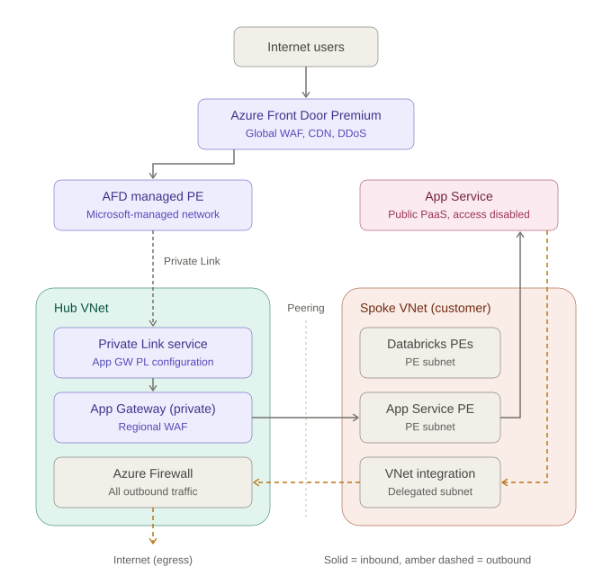
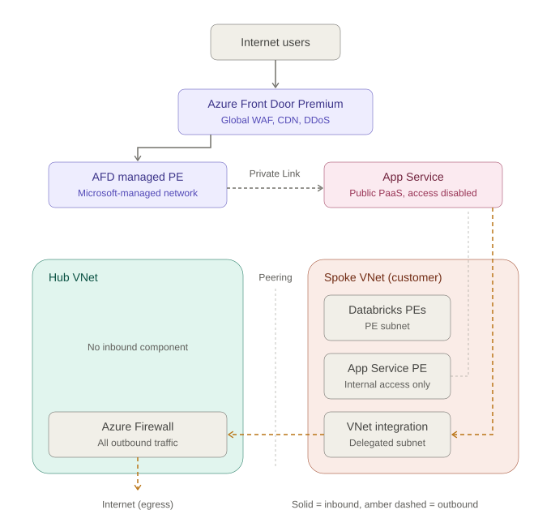
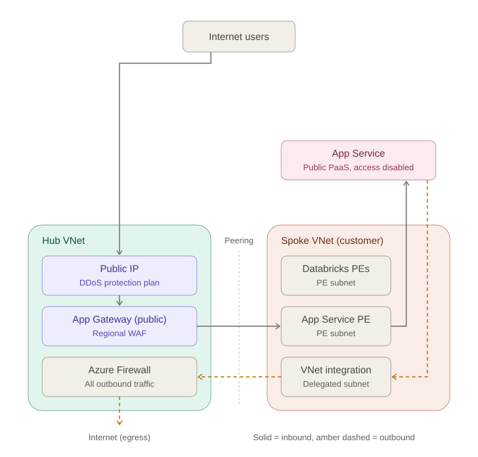

# Public Exposure of Spoke Web Applications – Option Comparison

**Context:** Hub-spoke topology with one spoke per customer. Each spoke hosts an Azure App Service and Azure Databricks with private endpoints in a subnet of the spoke VNet. The hub hosts Azure Firewall, and all outbound traffic from the spokes is forced through it. Spokes cannot reach each other.

**Options evaluated:**

- **Option 1:** Azure Front Door → Private Link → private Application Gateway (hub) → App Service private endpoint (spoke)
- **Option 2:** Azure Front Door → Private Link → App Service
- **Option 3:** Public Application Gateway → App Service

**Recommendation:** Option 2, unless a requirement exists for hub-owned inbound inspection or Application Gateway-only features (Option 1). Option 3 is the weakest fit for a hub-spoke design with forced tunnelling.

**Cost summary (West Europe, list prices, low traffic):** Option 2 is the cheapest at about €341 per month. Option 3 costs about €517 (€692 with DDoS IP Protection). Option 1 costs about €610 with a Standard_v2 gateway or €827 with WAF_v2. See [Cost Estimate](#cost-estimate--west-europe-front-door-and-application-gateway-only).

---

## Architecture Diagrams

All three diagrams share the same building blocks:

- Hub VNet and spoke VNet (one per customer), connected by VNet peering
- App Service as a public PaaS service with public network access disabled. It has a private endpoint and a VNet integration (delegated) subnet in the spoke.
- All outbound traffic: App Service → VNet integration → peering → Azure Firewall (hub) → internet
- Front Door (Options 1 and 2) always connects through an AFD-managed private endpoint in a Microsoft-managed network, using Private Link

Legend: solid grey arrows show inbound traffic, dashed grey arrows show Private Link, and amber dashed arrows show outbound traffic. The SVG files must sit in the same folder as this markdown file.

### Option 1: AFD → Private Link → private App Gateway (hub) → App Service PE (spoke)

### Option 2: AFD → Private Link → App Service

### Option 3: Public Application Gateway → App Service

---

## Pros and Cons

### Option 1: AFD → Private Link → private App Gateway (hub) → App Service PE (spoke)

**Pros**

- Two inspection layers: global WAF at the edge plus regional WAF in the hub
- Central, hub-owned ingress aligns with a hub-controlled governance model
- Application Gateway-only features available: rewrite rules, client mTLS, path-based routing to non-App Service backends
- Application Gateway has no public IP; nothing in the VNets is publicly exposed
- Global anycast edge, CDN caching and DDoS absorption at the edge

**Cons**

- Highest cost: Front Door Premium plus an Application Gateway, about €827 per month with WAF_v2 or €610 with Standard_v2 (low traffic, West Europe); that is 1.8 to 2.4 times Option 2
- Most complex: two WAFs to tune (duplicate false positives), two certificate chains, two health-probe layers
- Front Door Private Link to Application Gateway is newer than the App Service integration; some Microsoft docs still mark it as preview and portal support was missing, so GA status and IaC support need verification per region
- Shared hub Application Gateway is a blast radius for all customers and subject to listener and backend limits as customers grow; splitting it adds about €269 to €486 per extra gateway per month
- Extra hop adds latency
- Application Gateway → spoke private endpoint traffic crosses peering; UDRs on the gateway subnet and firewall rules need care to avoid asymmetric routing

### Option 2: AFD → Private Link → App Service

**Pros**

- Simplest design: fewest components and network hops
- No public exposure of the origin; App Service reachable only via Private Link
- Fits the per-customer spoke model: one Front Door profile, one origin group and WAF policy per customer
- Independent of hub routing, peering and firewall for inbound traffic; no UDR or asymmetric routing issues
- Global edge, CDN, managed certificates and DDoS protection at the edge
- Lowest cost of all three options: about €341 per month at low traffic and €794 at high traffic (West Europe), with no hourly gateway charge
- Lowest operational effort: no gateway to size, scale or patch

**Cons**

- Inbound traffic bypasses the hub, Azure Firewall and any regional WAF; Front Door WAF is the only inbound inspection (may conflict with an "all ingress via hub" policy)
- Requires Front Door Premium (Private Link is Premium-only); the €290 per month base fee applies regardless of traffic, and data transfer becomes the main cost at high traffic
- One private endpoint approval per App Service; additional endpoints and approvals if multiple Front Door profiles are used
- Front Door Private Link available only in regions with Availability Zone support
- No client-to-edge mTLS; fewer L7 rewrite and routing options than Application Gateway
- Less control over Front Door edge IPs and behaviour

### Option 3: Public Application Gateway → App Service

**Pros**

- No Front Door cost; about €517 per month at low traffic (West Europe), cheaper than Option 1 but more than Option 2
- Single, well-documented regional component
- Full Application Gateway feature set (mTLS, rewrites, WebSockets, long timeouts)
- Lower latency for users within a single region
- Traffic stays entirely within the VNets (Application Gateway → App Service private endpoint)

**Cons**

- Public IP inside the network; DDoS protection required to match Front Door edge protection: IP Protection adds about €175 per month (total about €692, roughly double Option 2), Network Protection about €2,590 per month
- Regional only: no global edge, CDN or anycast; multi-region failover needs Traffic Manager or similar
- Conflicts with forced tunnelling: a 0.0.0.0/0 UDR to the firewall on the gateway subnet breaks a public Application Gateway unless routing is designed carefully (e.g. dedicated subnet with an Internet route)
- In the hub it is a shared blast radius for all customers; per spoke it means N gateways at about €486 (WAF_v2) each per month
- Scaling, capacity units and certificates are self-managed
- Internet egress is billed separately (about €0.077 per GB after the first 100 GB)

---

## Criteria Comparison

| Criterion | Option 1: AFD → PL → private App GW → App Service PE | Option 2: AFD → PL → App Service | Option 3: Public App GW → App Service |
|---|---|---|---|
| Public attack surface in the VNets | None | None | Application Gateway public IP |
| Edge DDoS / global WAF | Yes | Yes | No (regional WAF; DDoS plan needed) |
| Inbound traffic passes through the hub | Yes (Application Gateway) | No | Yes, if gateway is placed in the hub |
| Fit with forced tunnelling | Fine (private gateway) | Best (not affected) | Awkward |
| Customer isolation | Shared gateway | Per origin, per WAF policy | Shared, or N gateways |
| Complexity | High | Low | Medium |
| Monthly cost, West Europe, low traffic | ~€827 (WAF_v2) / ~€610 (Standard_v2) | ~€341 | ~€517, or ~€692 with DDoS IP Protection |
| Monthly cost, West Europe, high traffic | ~€1,280 (WAF_v2) / ~€1,063 (Standard_v2) | ~€794 | ~€861, or ~€1,037 with DDoS IP Protection |
| Cost ranking (1 = cheapest) | 4 (WAF_v2) / 3 (Standard_v2) | 1 | 2 (3 with DDoS IP Protection) |
| Feature maturity | AFD → App GW Private Link GA status to be verified | Mature (GA for years) | Mature |

*Cost figures: see the Cost Estimate section.*

---

## Cost Estimate – West Europe (Front Door and Application Gateway only)

Rough monthly list prices, excluding VAT and discounts. The prices come from the Azure Retail Prices API (October 2026): region `westeurope` for Application Gateway, and Front Door Zone 6 (Europe). All amounts are in EUR.

Only Azure Front Door and Application Gateway are included. App Service, private endpoints, Databricks, Azure Firewall and peering are the same in all three options and are left out.

### Unit prices used (West Europe)

| Item | Price | Notes |
|---|---|---|
| Front Door Premium base fee | €290.39 / month | Per profile; one shared profile for all customers. Private Link and managed WAF rules included |
| Front Door Premium requests | €0.0132 per 10,000 | Zone 6 (Europe), first 250 million requests |
| Front Door edge → client | €0.0726 / GB | First 10 TB |
| Front Door edge → origin | €0.0176 / GB | Cache misses and request bodies |
| Application Gateway WAF_v2, fixed | €0.4118 / hour | |
| Application Gateway WAF_v2, capacity unit | €0.0127 / CU-hour | |
| Application Gateway Standard_v2, fixed | €0.2288 / hour | |
| Application Gateway Standard_v2, capacity unit | €0.007 / CU-hour | |
| Internet egress from West Europe (Option 3) | €0.0766 / GB | First 100 GB per month free; Microsoft network routing |
| DDoS IP Protection (Option 3, not in scope) | €0.2399 / hour (≈ €175 / month) | Per protected public IP |
| DDoS Network Protection (Option 3, not in scope) | €3.5483 / hour (≈ €2,590 / month) | Covers up to 100 public IPs |

Assumptions:

- 730 hours per month
- One shared Application Gateway in the hub, autoscale with minimum 2 instances for availability. Each instance reserves 10 capacity units (CUs), so 20 CUs are billed at all times. Both traffic scenarios stay within those 20 CUs.
- One shared Front Door Premium profile for all customers

### Traffic scenarios

| Scenario | Requests / month | Data to clients / month | Edge → origin / month |
|---|---|---|---|
| Low | 10 million | 500 GB | 50 GB |
| High | 100 million | 5 TB | 500 GB |

### Monthly cost per option (EUR)

| Cost component | Option 1 (WAF_v2) | Option 1 (Standard_v2) | Option 2 | Option 3 |
|---|---|---|---|---|
| Front Door, low traffic | €341 | €341 | €341 | – |
| Application Gateway | €486 | €269 | – | €486 |
| Internet egress via App GW, low traffic | – | – | – | €31 |
| **Total, low traffic** | **~€827** | **~€610** | **~€341** | **~€517** |
| **Total, high traffic** | **~€1,280** | **~€1,063** | **~€794** | **~€861** |
| Annual, low traffic | ~€9,920 | ~€7,320 | ~€4,090 | ~€6,200 |
| Annual, high traffic | ~€15,360 | ~€12,760 | ~€9,530 | ~€10,340 |

Front Door breakdown:

- Low traffic: €290 base + €13 requests + €36 egress + €1 to origin
- High traffic: €290 + €132 + €363 + €9

Application Gateway breakdown:

- WAF_v2: €301 fixed + €185 for the 20 reserved CUs
- Standard_v2: €167 fixed + €102 for the 20 reserved CUs

### Notes

- **Option 2 is the cheapest** in both scenarios. Its cost is driven by the base fee at low traffic and by data transfer at high traffic.
- **Option 1 always costs Option 2 plus one Application Gateway.** If the Front Door WAF is the only WAF layer, Standard_v2 is enough in the hub and saves about €217 per month compared with WAF_v2.
- **Option 3 needs DDoS protection** on its public IP to match the edge protection Front Door provides. That cost is outside the scope above but changes the comparison:
  - With DDoS IP Protection (about €175 per month), Option 3 comes to about €692 per month at low traffic, roughly double Option 2.
  - DDoS Network Protection (about €2,590 per month) only makes sense if it is already in place for the hub. When it is, WAF_v2 is billed at the Standard_v2 rate.
- **Scaling with customers:** with one shared profile and one shared gateway, these costs barely grow per customer. A separate Application Gateway per spoke would add about €486 (WAF_v2) or €269 (Standard_v2) per customer per month. A separate Front Door profile per customer would add €290 per customer per month.
- These are list prices. Enterprise agreements and reservations will lower them. Confirm with the [Azure pricing calculator](https://azure.microsoft.com/pricing/calculator/) before budgeting.

---

## Decision Guidance

| Option | When to choose | Notes |
|---|---|---|
| **Option 2 (preferred)** | App Service is the only component exposed per customer and the Front Door WAF satisfies the security policy | Cheapest option at about €341 per month (low traffic). App Service public network access disabled so only the Front Door private endpoint can reach it; outbound traffic continues through the hub firewall via VNet integration and UDR |
| **Option 1** | A hub-owned inbound inspection point is mandated, client mTLS or Application Gateway rewrite rules are needed, or non-App Service backends will be exposed from the spokes later | Costs about €270 to €490 per month more than Option 2. Use Standard_v2 if the Front Door WAF is the only WAF layer. Plan one Application Gateway per group of customers if listener limits or blast radius become a concern |
| **Option 3** | All users are in a single region, Front Door is to be avoided, and DDoS protection plus forced-tunnelling routing exceptions are acceptable | Weakest fit for a hub-spoke design with forced tunnelling. Not a cost saving once DDoS IP Protection is added (about €692 vs €341 per month for Option 2) |

---

## Sources

- [Secure your origin with Private Link in Azure Front Door Premium (Microsoft Learn)](https://learn.microsoft.com/azure/frontdoor/private-link)
- [Front Door private link docs (GitHub)](https://github.com/MicrosoftDocs/azure-docs/blob/main/articles/frontdoor/private-link.md)
- [Azure Front Door origin security (Microsoft Learn)](https://learn.microsoft.com/azure/frontdoor/origin-security)
- [Azure Front Door pricing (Microsoft)](https://azure.microsoft.com/pricing/details/frontdoor/)
- [Understanding Azure Front Door pricing (Microsoft Docs, GitHub)](https://github.com/MicrosoftDocs/azure-docs/blob/main/articles/frontdoor/understanding-pricing.md)
- [Understanding Application Gateway pricing (Microsoft Learn)](https://learn.microsoft.com/azure/application-gateway/understanding-pricing)
- [Azure Retail Prices API (Microsoft)](https://learn.microsoft.com/rest/api/cost-management/retail-prices/azure-retail-prices)
- [Azure DDoS Protection pricing (Microsoft)](https://azure.microsoft.com/pricing/details/ddos-protection/)
