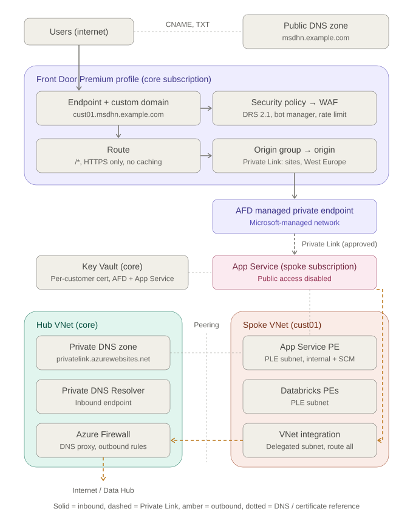

# Ingress Option 2 – Detailed Design

**Pattern:** Azure Front Door Premium → Private Link → App Service

**Scope:** Exposing each customer's App Service on the public internet through Azure Front Door Premium. Front Door reaches the App Service over Private Link only. Outbound traffic from the App Service keeps going through Azure Firewall in the Core Hub.

**Related:** [Ingress option comparison](Ingress_Options_Comparison.md)

---

## 1. Design summary

| Area | Decision |
|---|---|
| Edge | One shared Azure Front Door **Premium** profile in the core subscription. Each customer gets its own endpoint, custom domain, route, origin group and WAF policy. |
| Public hostname | `<customer>.msdhn.example.com` per customer (for example `cust01.msdhn.example.com`) |
| Certificates | **One certificate per customer**, for that customer's domain only (for example `cust01.msdhn.example.com`). Stored in Key Vault and renewed automatically. No wildcard certificates. |
| Edge TLS | The customer's certificate from Key Vault (bring your own certificate), TLS 1.2 minimum |
| Front Door → App Service | Private Link origin, target sub-resource `sites`, Private Link region **West Europe**, connection approved on the App Service |
| Host name | Preserved end to end: the App Service receives `Host: <customer>.msdhn.example.com` |
| Origin TLS | HTTPS only; the App Service presents the same customer certificate (imported from Key Vault); Front Door validates the certificate name |
| App Service public access | Disabled. The only paths in are the Front Door managed private endpoint and the spoke private endpoint. |
| Internal access | App Service private endpoint in the spoke PLE subnet, for internal callers and deployments (SCM / Kudu) |
| Outbound | VNet integration with route-all, UDR `0.0.0.0/0` → Azure Firewall private IP |
| DNS (private) | `privatelink.azurewebsites.net` zone linked to the Core Hub VNet only; spoke resolves through the Azure Firewall DNS proxy → Private DNS Resolver |
| WAF | Prevention mode, Microsoft Default Rule Set 2.1, Bot Manager 1.1, rate-limit custom rule |

> **Note:** In Option 2 there is **no Private Link service** in the hub or spoke. A Private Link service is only needed in front of a load balancer or Application Gateway (Option 1). Here, App Service is itself the Private Link resource, and Front Door creates a **managed private endpoint** to it, inside a Microsoft-managed network.

---

## 2. Naming and placeholders

The domain `msdhn.example.com` and customer key `cust01` are placeholders. Replace them with the real domain and customer keys.

| Item | Proposed name | Location |
|---|---|---|
| Front Door profile | `afd-msdhn-prd` | Core subscription, `rg-msdhn-ingress-prd` |
| Front Door endpoint | `fde-msdhn-cust01-prd` → `fde-msdhn-cust01-prd-<hash>.z01.azurefd.net` | Front Door profile |
| Custom domain resource | `cust01-msdhn-example-com` | Front Door profile |
| Origin group | `og-cust01-app` | Front Door profile |
| Origin | `or-cust01-app` | Origin group |
| Route | `rt-cust01-app` | Endpoint |
| WAF policy | `wafmsdhncust01prd` (letters and digits only) | Core subscription |
| Security policy | `sp-cust01` | Front Door profile |
| Key Vault | `kv-msdhn-core-prd` | Core subscription |
| Certificate (per customer) | `cert-cust01-msdhn-example-com` | Key Vault |
| App Service | `app-msdhn-cust01-prd` | Customer subscription |
| App Service plan | `asp-msdhn-cust01-prd` | Customer subscription |
| App Service private endpoint | `pe-app-msdhn-cust01-prd` | Spoke VNet, PLE subnet |
| VNet integration subnet | `snet-cust01-appsvc-int` | Spoke VNet |
| Log Analytics workspace | `log-msdhn-core-prd` | Core subscription |

---

## 3. Architecture



### Request flow (inbound)

1. A user opens `https://cust01.msdhn.example.com`. Public DNS returns a CNAME to `fde-msdhn-cust01-prd-<hash>.z01.azurefd.net`, which resolves to the nearest Front Door point of presence.
2. Front Door terminates TLS with the customer's certificate for `cust01.msdhn.example.com`.
3. The WAF policy attached to the custom domain inspects the request. Blocked requests get a 403.
4. The route `rt-cust01-app` matches the domain and `/*` and forwards over HTTPS to origin group `og-cust01-app`.
5. Front Door connects to the App Service through its **managed private endpoint** in West Europe, over the Microsoft backbone. It sends `Host: cust01.msdhn.example.com`, uses that name for SNI, and validates the App Service certificate against it.
6. The App Service handles the request. The response returns along the same path.

### Request flow (outbound)

7. Calls from the App Service go through VNet integration into `snet-cust01-appsvc-int`.
8. The UDR sends `0.0.0.0/0` to the Azure Firewall private IP in the Core Hub. Azure Firewall allows or denies the call based on its rules (internet, Data Hub private endpoints, Databricks, and so on).

---

## 4. Domain names and DNS

### 4.1 Public DNS records (zone `msdhn.example.com`)

| Record | Type | Value | Purpose |
|---|---|---|---|
| `cust01` | CNAME | `fde-msdhn-cust01-prd-<hash>.z01.azurefd.net` | Sends users to Front Door |
| `_dnsauth.cust01` | TXT | Validation token from Front Door | Domain ownership validation in Front Door (only needed when ownership isn't validated through the certificate; see 5.3) |
| `asuid.cust01` | TXT | App Service custom domain verification ID | Lets the App Service bind `cust01.msdhn.example.com` without the CNAME pointing to App Service |

Notes:

- Use a subdomain per customer. An apex domain (`msdhn.example.com` itself) can't be a CNAME; it would need Azure DNS alias records.
- Don't create a CNAME from the custom domain to `*.azurewebsites.net`. That would expose the App Service's default host name and bypass the WAF; since public access is disabled, it wouldn't work anyway.

### 4.2 Private DNS (internal resolution)

| Zone | Linked to | Records | Created by |
|---|---|---|---|
| `privatelink.azurewebsites.net` | Core Hub VNet only | `app-msdhn-cust01-prd` → private IP of `pe-app-msdhn-cust01-prd`, and `app-msdhn-cust01-prd.scm` → same IP | Private DNS zone group on the private endpoint |

Resolution path from inside the spoke (for example, a build agent or another workload):

1. A client in the spoke asks for `app-msdhn-cust01-prd.azurewebsites.net`. The spoke's custom DNS points to Azure Firewall.
2. Azure Firewall (DNS proxy) forwards the query to the Private DNS Resolver inbound endpoint in the Core Hub.
3. The query follows the CNAME to `app-msdhn-cust01-prd.privatelink.azurewebsites.net`, which the hub-linked private zone answers with the private endpoint IP.

Front Door does **not** use this zone. Its managed private endpoint lives in a Microsoft-managed network and has its own resolution.

---

## 5. Azure Front Door configuration

### 5.1 Profile

| Setting | Value |
|---|---|
| SKU | `Premium_AzureFrontDoor` (needed for Private Link and managed WAF rules) |
| Managed identity | System-assigned, granted **Key Vault Secrets User** on each customer certificate in `kv-msdhn-core-prd` (scoped to the individual certificate, or to the vault) |
| Origin response timeout | 60 seconds (raise only for long-running requests) |
| Diagnostic settings | `FrontDoorAccessLog`, `FrontDoorHealthProbeLog`, `FrontDoorWebApplicationFirewallLog` → `log-msdhn-core-prd` |

### 5.2 Endpoint

| Setting | Value |
|---|---|
| Name | `fde-msdhn-cust01-prd` (one endpoint per customer) |
| Enabled state | Enabled |
| Auto-generated host name | `fde-msdhn-cust01-prd-<hash>.z01.azurefd.net`; used only as the CNAME target, not linked to any route |

Using one endpoint per customer keeps each customer's routes, logs and default host name separate. Check the per-profile limits for endpoints, domains and routes in the [Front Door service limits](https://learn.microsoft.com/azure/azure-resource-manager/management/azure-subscription-service-limits) when planning the number of customers per profile.

### 5.3 Custom domain and certificate

| Setting | Value |
|---|---|
| Host name | `cust01.msdhn.example.com` |
| Certificate type | Bring your own certificate: Key Vault certificate `cert-cust01-msdhn-example-com`, version set to **Latest** so renewals are picked up automatically |
| Minimum TLS version | TLS 1.2 |
| Domain validation | Automatic, because the certificate's subject name matches the domain; otherwise through the `_dnsauth` TXT record |

Why a customer certificate from Key Vault and not a Front Door managed certificate: the App Service also needs a certificate for `cust01.msdhn.example.com` (see 7.2). A Front Door managed certificate can't be exported, and an App Service managed certificate can't be issued because the domain doesn't point to App Service. One certificate per customer in Key Vault covers both Front Door and that customer's App Service, with one renewal process.

### 5.4 Certificate lifecycle (per customer)

| Setting | Value |
|---|---|
| Certificate name | `cert-<customer>-msdhn-example-com` (for example `cert-cust01-msdhn-example-com`) |
| Subject | `CN=cust01.msdhn.example.com` |
| Subject alternative names | `cust01.msdhn.example.com` only |
| Issuer | A public CA integrated with Key Vault (DigiCert or GlobalSign), so Key Vault can request and renew the certificate itself. A non-integrated CA works too, but then each renewal is a manual CSR and merge. |
| Key | RSA 2048 (or 3072) |
| Validity | 1 year or less, per CA policy |
| Renewal | Key Vault lifetime action **AutoRenew**, 30 days before expiry, plus an email or Event Grid notification |
| Pick-up of the new version | Front Door uses the **Latest** version and switches automatically; App Service syncs certificates imported from Key Vault automatically. Both can take a day or more, which is why renewal starts 30 days early. |
| Access | Front Door identity and the App Service resource provider get **Key Vault Secrets User** on that customer's certificate only |
| Monitoring | Alert on certificates expiring within 21 days (Key Vault `CertificateNearExpiry` event or Azure Policy) |

Onboarding a new customer adds one certificate request. Offboarding revokes and deletes that customer's certificate without touching any other customer.

### 5.5 Origin group

| Setting | Value |
|---|---|
| Name | `og-cust01-app` |
| Session affinity | Disabled (enable only if the app needs it) |
| Health probe | **Disabled** while there is only one origin. Probes from every Front Door point of presence add load and give no failover benefit with a single origin. Enable when a second origin (another region) is added: `HEAD /health`, HTTPS, every 60 seconds. |
| Load balancing | Defaults: sample size 4, successful samples 3, latency sensitivity 50 ms |

A Private Link origin can't share an origin group with public origins.

### 5.6 Origin (Private Link)

| Setting | Value |
|---|---|
| Name | `or-cust01-app` |
| Origin type | App services |
| Host name | `app-msdhn-cust01-prd.azurewebsites.net` |
| Origin host header | **Empty (null)**, so the client host name `cust01.msdhn.example.com` is passed through |
| HTTPS port | 443 (HTTP port 80 set but not used) |
| Certificate subject name validation | Enabled |
| Priority / weight | 1 / 1000 |
| Private Link | Enabled |
| Private Link resource | `/subscriptions/<cust01-sub>/resourceGroups/<rg>/providers/Microsoft.Web/sites/app-msdhn-cust01-prd` |
| Target sub-resource | `sites` |
| Private Link region | West Europe (same as the App Service) |
| Request message | `Azure Front Door afd-msdhn-prd → app-msdhn-cust01-prd` |

### 5.7 Route

| Setting | Value |
|---|---|
| Name | `rt-cust01-app` |
| Domains | `cust01.msdhn.example.com` only. The endpoint's default domain is **not** linked, so the `azurefd.net` host name returns 404. |
| Patterns to match | `/*` |
| Accepted protocols | HTTP and HTTPS |
| Redirect | HTTP → HTTPS |
| Forwarding protocol | HTTPS only |
| Origin group | `og-cust01-app` |
| Caching | Disabled (dynamic application). Static paths can get their own route with caching later. |
| Rule set | `rs-security-headers` (optional, see 5.9) |

### 5.8 WAF policy and security policy

**WAF policy** `wafmsdhncust01prd`:

| Setting | Value |
|---|---|
| SKU | `Premium_AzureFrontDoor` |
| Mode | **Detection** during onboarding, then **Prevention** once false positives are tuned |
| Request body inspection | Enabled |
| Managed rule set | `Microsoft_DefaultRuleSet` 2.1, action Block (anomaly scoring) |
| Managed rule set | `Microsoft_BotManagerRuleSet` 1.1 |
| Custom rule: rate limit | Per client IP, for example 1,000 requests per minute → Block (tune per customer) |
| Custom rule: geo filter | Optional, for example allow EU only if the customer requires it |
| Custom block response | 403 with a short page that includes the tracking reference |

**Security policy** `sp-cust01` associates the WAF policy with domain `cust01.msdhn.example.com`. Each customer has its own WAF policy, so rules can be tuned per customer without affecting the others.

### 5.9 Rule set (optional)

`rs-security-headers` adds response headers at the edge:

- `Strict-Transport-Security: max-age=31536000; includeSubDomains`
- `X-Content-Type-Options: nosniff`
- `Referrer-Policy: strict-origin-when-cross-origin`

---

## 6. Private Link connection (Front Door → App Service)

| Aspect | Detail |
|---|---|
| What gets created | A managed private endpoint owned by Front Door, in a Microsoft-managed network in West Europe. It doesn't appear in the hub or spoke VNets and uses no customer IP addresses. |
| Where it shows up | A **pending** connection on the App Service: *Networking → Private endpoint connections*, with the request message from 5.6 |
| Approval | Required once per App Service (and again if another Front Door profile connects to it). Until it's approved, Front Door returns an error for the route. |
| Effect on public access | None needed: with App Service public network access disabled, approved private endpoint connections still work |
| Cost | Included in Front Door Premium |

Approval with the Azure CLI:

```sh
# List connections on the App Service and find the pending one from Front Door
az network private-endpoint-connection list \
  --name app-msdhn-cust01-prd \
  --resource-group <rg> \
  --type Microsoft.Web/sites

# Approve it
az network private-endpoint-connection approve \
  --id <connection-resource-id> \
  --description "Approved for afd-msdhn-prd"
```

In IaC, the connection name is generated by Azure, so approval is usually a post-deployment step: look up the pending connection on `Microsoft.Web/sites/privateEndpointConnections` and set its status to `Approved`.

---

## 7. App Service configuration

### 7.1 Plan and networking

| Setting | Value |
|---|---|
| Plan | Premium v3 (supports private endpoints, VNet integration and zone redundancy) |
| Zone redundancy | Enabled, minimum 3 instances (or 2 non-zonal instances for lower environments) |
| Public network access | **Disabled** (covers both the main site and the SCM site) |
| HTTPS only | On |
| Minimum TLS version | 1.2 |
| FTP / FTPS | Disabled |
| Client affinity (ARR) | Off, unless the app needs session affinity |
| Health check path | `/health` (used by App Service itself to replace unhealthy instances) |

### 7.2 Custom domain and certificate

| Setting | Value |
|---|---|
| Custom domain | `cust01.msdhn.example.com`, verified with the `asuid.cust01` TXT record |
| Certificate | Imported from Key Vault `kv-msdhn-core-prd` / `cert-cust01-msdhn-example-com` (the same certificate Front Door uses). The `Microsoft.Web` resource provider needs **Key Vault Secrets User** on this certificate. |
| Binding | SNI SSL |

Because the host name is preserved, cookies, redirects and sign-in callbacks (Microsoft Entra ID redirect URIs) all use `cust01.msdhn.example.com`.

### 7.3 Application settings

- Trust forwarded headers only from Front Door: `X-Forwarded-For`, `X-Forwarded-Proto` and `X-Forwarded-Host`. In ASP.NET Core, Spring Boot or similar, enable forwarded-header handling, so the app knows the original request was HTTPS and doesn't loop on redirects.
- Optionally check that the `X-Azure-FDID` header matches the Front Door profile ID, as defence in depth.

### 7.4 Private endpoint (internal access)

| Setting | Value |
|---|---|
| Name | `pe-app-msdhn-cust01-prd` |
| Subnet | Spoke PLE subnet (same subnet as the Databricks private endpoints) |
| Target sub-resource | `sites` |
| DNS | Private DNS zone group → `privatelink.azurewebsites.net` in the Core Hub (cross-subscription) |
| Used by | Internal callers in the MSDHN platform, and CI/CD deployments to the SCM site from self-hosted build agents that can reach the spoke |

This private endpoint is **not** used by Front Door.

### 7.5 VNet integration (outbound)

| Setting | Value |
|---|---|
| Subnet | `snet-cust01-appsvc-int`, size /26, delegated to `Microsoft.Web/serverFarms`, not shared with other resources |
| Outbound routing | Route all traffic through the VNet (`vnetRouteAllEnabled` / outbound VNet routing: all traffic) |
| Route table | `0.0.0.0/0` → Azure Firewall private IP (same as other spoke subnets) |
| DNS | Uses the spoke VNet's custom DNS (Azure Firewall DNS proxy) |

---

## 8. Spoke and hub network changes

### 8.1 Spoke VNet (per customer)

| Subnet | Purpose | Notes |
|---|---|---|
| PLE subnet (existing) | Databricks private endpoints plus the App Service private endpoint | Private endpoint network policies enabled if NSG / UDR control is wanted on private endpoints |
| `snet-cust01-appsvc-int` (new) | App Service VNet integration | /26, delegated, route table with `0.0.0.0/0` → firewall, NSG allowing outbound only |

No inbound NSG rules are needed for Front Door: its traffic arrives through Private Link, not through the spoke.

### 8.2 Core Hub

| Component | Change |
|---|---|
| Azure Firewall | Application rules for the App Service's outbound dependencies (by FQDN), network rules for private destinations (Data Hub, Databricks); DNS proxy already enabled |
| Private DNS zone | Add `privatelink.azurewebsites.net` (linked to the Core Hub VNet) if it doesn't exist yet |
| Key Vault | Store one certificate per customer (`cert-<customer>-msdhn-example-com`) with auto-renewal; grant the Front Door identity and the App Service resource provider access per certificate |
| Log Analytics | Receives Front Door, WAF and App Service logs |

---

## 9. Security checklist

- [ ] App Service public network access disabled (main site and SCM)
- [ ] Front Door Private Link connection approved; no other unexpected private endpoint connections on the App Service
- [ ] Route linked to the custom domain only; default `azurefd.net` domain not linked
- [ ] HTTPS only end to end, TLS 1.2 minimum at Front Door and App Service
- [ ] WAF in Prevention mode with Default Rule Set 2.1 and Bot Manager 1.1 after tuning
- [ ] Rate-limit custom rule in place per customer
- [ ] One certificate per customer, covering only that customer's domain; no wildcard certificates
- [ ] Certificates stored in Key Vault with auto-renewal 30 days before expiry, accessed through managed identity, picked up through the "Latest" version
- [ ] Expiry alert in place for every customer certificate
- [ ] App honours forwarded headers only from Front Door
- [ ] Outbound traffic forced through Azure Firewall (route-all + UDR)
- [ ] Front Door, WAF and App Service logs in Log Analytics, with alerts on WAF blocks and 5xx rates

---

## 10. Resource map for IaC

| Resource | ARM type | Owner stack |
|---|---|---|
| Front Door profile | `Microsoft.Cdn/profiles` | Core |
| Endpoint | `Microsoft.Cdn/profiles/afdEndpoints` | Core (per customer) |
| Custom domain | `Microsoft.Cdn/profiles/customDomains` | Core (per customer) |
| Certificate reference | `Microsoft.Cdn/profiles/secrets` | Core |
| Origin group | `Microsoft.Cdn/profiles/originGroups` | Core (per customer) |
| Origin (Private Link) | `Microsoft.Cdn/profiles/originGroups/origins` | Core (per customer) |
| Route | `Microsoft.Cdn/profiles/afdEndpoints/routes` | Core (per customer) |
| Rule set | `Microsoft.Cdn/profiles/ruleSets` | Core |
| WAF policy | `Microsoft.Network/FrontDoorWebApplicationFirewallPolicies` | Core (per customer) |
| Security policy | `Microsoft.Cdn/profiles/securityPolicies` | Core (per customer) |
| Private endpoint connection approval | `Microsoft.Web/sites/privateEndpointConnections` | Customer (post-deployment step) |
| App Service plan / App Service | `Microsoft.Web/serverfarms`, `Microsoft.Web/sites` | Customer |
| App Service certificate | `Microsoft.Web/certificates` | Customer |
| Host name binding | `Microsoft.Web/sites/hostNameBindings` | Customer |
| App Service private endpoint | `Microsoft.Network/privateEndpoints` (+ `privateDnsZoneGroups`) | Customer |
| Integration subnet | `Microsoft.Network/virtualNetworks/subnets` | Spoke |
| Public DNS records | `Microsoft.Network/dnszones/CNAME`, `TXT` (or the external DNS provider) | Core |

Deployment order: spoke subnets → App Service with private endpoint and VNet integration → customer certificate in Key Vault → Front Door profile, WAF policy, endpoint, custom domain, origin group, origin → approve the Private Link connection → route and security policy → public DNS CNAME → App Service custom domain binding.

---

## 11. Open decisions

| Decision | Options | Proposed |
|---|---|---|
| Domain per customer | Subdomain of a platform domain, or the customer's own domain | Platform subdomain `<customer>.msdhn.example.com` |
| Certificate model | One certificate per customer, wildcard certificate, or Front Door managed certificate | **Decided:** one certificate per customer in Key Vault, used by Front Door and App Service |
| Certificate authority | Key Vault-integrated CA (DigiCert, GlobalSign) or another CA | Integrated CA, for automatic renewal |
| Host name preservation | Preserve the custom domain, or forward the `azurewebsites.net` default host name | Preserve |
| Endpoint layout | One endpoint per customer, or a shared endpoint with one route per domain | One endpoint per customer |
| WAF policy layout | One policy per customer, or one shared policy | One per customer |
| CI/CD to App Service | Self-hosted agents with access to the spoke private endpoint, or temporary access restrictions | Self-hosted agents |

---

## Sources

- [Connect Azure Front Door Premium to an App Service origin with Private Link (Microsoft Learn)](https://learn.microsoft.com/azure/frontdoor/standard-premium/how-to-enable-private-link-web-app)
- [Secure your origin with Private Link in Azure Front Door Premium (Microsoft Learn)](https://learn.microsoft.com/azure/frontdoor/private-link)
- [Preserve the original HTTP host name between a reverse proxy and its back-end web application (Azure Architecture Center)](https://learn.microsoft.com/azure/architecture/best-practices/host-name-preservation)
- [Add a custom domain to Azure Front Door (Microsoft Learn)](https://learn.microsoft.com/azure/frontdoor/standard-premium/how-to-add-custom-domain)
- [Azure Front Door routing limits (Microsoft Learn)](https://learn.microsoft.com/azure/frontdoor/front-door-routing-limits)
- [Azure subscription and service limits (Microsoft Learn)](https://learn.microsoft.com/azure/azure-resource-manager/management/azure-subscription-service-limits)
