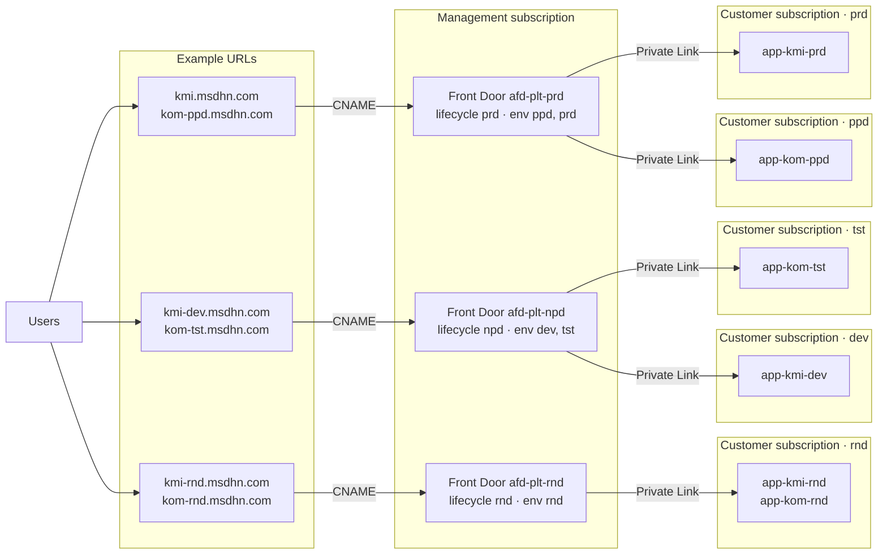
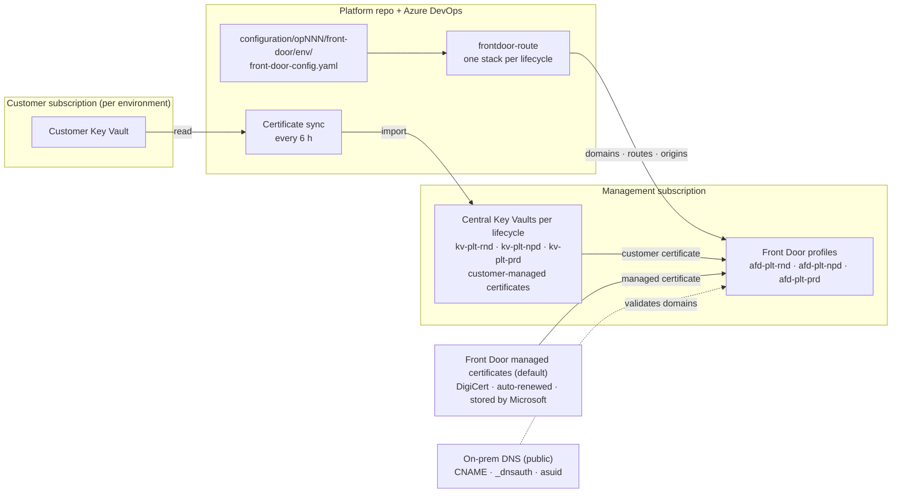

# Azure Front Door Design

## Context

- The platform runs on Azure in a hub-spoke topology: every spoke serves one customer, the hub and the management subscription hold shared services.
- Each customer can run multiple applications, each on its own App Service per environment, in a customer subscription per environment.
- Environments: `rnd`, `dev`, `tst`, `ppd` (pre-production) and `prd`, grouped into the lifecycles `rnd` (rnd), `npd` (dev, tst) and `prd` (ppd, prd).- App Services are reachable **only through Front Door** (public network access disabled, Private Link origin).
- `msdhn.com` is the organization's root domain. Its public DNS is served by an on-premises DNS server managed by a central team; record requests are manual.
- Host names identify the application only; the customer is not part of the name (see `domain_name_design.md`).

---

## Architecture overview

**Terms**

- **Lifecycle:** `rnd`, `npd`, `prd`. Each lifecycle has its own Front Door profile.
- **Environment:** `rnd`, `dev`, `tst`, `ppd`, `prd`. Lifecycle `rnd` holds environment `rnd`; lifecycle `npd` holds `dev` and `tst`; lifecycle `prd` holds `ppd` and `prd`. Each customer has its own subscription per environment for the backend App Services.

| Lifecycle | Front Door profile | Environments | Backend App Services (customer subscriptions) |
|---|---|---|---|
| rnd | `afd-plt-rnd` | rnd | rnd |
| npd | `afd-plt-npd` | dev, tst | dev, tst |
| prd | `afd-plt-prd` | ppd, prd | ppd, prd |

### Request flow



### Configuration and certificates



Rendered versions: `frontdoor_architecture_traffic.png` and `frontdoor_architecture_config.png`.

---

## Decisions

| Topic | Decision |
|---|---|
| Placement | Front Door is a central service in the management subscription (`shared-service` project), owned by the platform team. |
| Profiles | Two Premium profiles: `afd-plt-np` (dev, tst) and `afd-plt-prd` (ppd, prd). |
| Endpoints | `fde-plt-np` in the non-prod profile; `fde-plt-ppd` and `fde-plt-prd` in the prod profile. |
| Host names | Flat names under `msdhn.com` for every environment, for example `kmi.msdhn.com` (prd), `kmi-ppd.msdhn.com`, `kmi-tst.msdhn.com`, `kmi-dev.msdhn.com`, `kmi-rnd.msdhn.com`. |
| Certificate scope | One certificate per application per environment, for exactly that host name (for example `kmi.msdhn.com`, `kmi-dev.msdhn.com`). No wildcard or shared certificates, so an expired or compromised certificate affects one application in one environment only. |
| Certificates | Per application and environment: Front Door managed certificate (DigiCert, default) or the customer's own certificate, copied from the customer Key Vault to the central Key Vault of its lifecycle. |
| App Service | Custom domain added (host header preserved), no certificate binding. |
| Non-prod access | WAF allows corporate IP ranges only. |
| Self-service | One file per customer per environment (`configuration/<customer>/front-door/<environment>/front-door-config.yaml`) in the platform repo, changed through pull requests and combined during validation. |

---

## Host names

Flat names under `msdhn.com` for every environment. Example for application `kmi`:

| Lifecycle | Environment | Host | Front Door profile / endpoint |
|---|---|---|---|
| rnd | rnd | `kmi-rnd.msdhn.com` | `afd-plt-rnd` / `fde-plt-rnd` |
| npd | dev | `kmi-dev.msdhn.com` | `afd-plt-npd` / `fde-plt-npd` |
| npd | tst | `kmi-tst.msdhn.com` | `afd-plt-npd` / `fde-plt-npd` |
| prd | ppd | `kmi-ppd.msdhn.com` | `afd-plt-prd` / `fde-plt-ppd` |
| prd | prd | `kmi.msdhn.com` | `afd-plt-prd` / `fde-plt-prd` |

- Pattern: `<app>-<env>.msdhn.com`, except production: `<app>.msdhn.com`.
- The suffixes `-rnd`, `-dev`, `-tst` and `-ppd` are reserved for environments.
- Application names follow the naming rules in `domain_name_design.md` (unique within `msdhn.com`, agreed with the central team, reserved names excluded).

---

## Front Door layout

| Item | One per | Owned by stack |
|---|---|---|
| Profile | Lifecycle (`afd-plt-rnd`, `afd-plt-npd`, `afd-plt-prd`) | shared-service |
| Endpoint | `fde-plt-rnd`, `fde-plt-npd`; `fde-plt-ppd` and `fde-plt-prd` in the prd profile | shared-service |
| WAF policies | Profile / environment | shared-service |
| Security policies (WAF policy ↔ domains) | `frontdoor-route` stack | frontdoor-route |
| Custom domain | Application and environment | frontdoor-route |
| Route | Host name (application and environment) | frontdoor-route |
| Origin group and origin | Application and environment | frontdoor-route |
| Secret (reference to the central Key Vault certificate) | Application and environment with a customer certificate | frontdoor-route |

- **Delete locks** on profiles and endpoints. Deleting an endpoint breaks every CNAME pointing at it.
- Endpoints keep the default name-reuse scope (`TenantReuse`) so a redeployed endpoint keeps its host name.
- No rule sets and no wildcard domains: every host has its own route to its own origin group.
- Origin host header is empty, so the public host name is passed through to the App Service.
- Disabling an endpoint takes every application on it offline; a single application is taken offline by disabling its route.

### One route per host name

Every host name has exactly one route: one route per application **per environment**. Each route has one custom domain, the pattern `/*` and its own origin group. Example for `kmi`:

| Host | Route | Origin group → App Service |
|---|---|---|
| `kmi-rnd.msdhn.com` | `rt-kmi-rnd` | `og-kmi-rnd` → `app-kmi-rnd` |
| `kmi-dev.msdhn.com` | `rt-kmi-dev` | `og-kmi-dev` → `app-kmi-dev` |
| `kmi-tst.msdhn.com` | `rt-kmi-tst` | `og-kmi-tst` → `app-kmi-tst` |
| `kmi-ppd.msdhn.com` | `rt-kmi-ppd` | `og-kmi-ppd` → `app-kmi-ppd` |
| `kmi.msdhn.com` | `rt-kmi-prd` | `og-kmi-prd` → `app-kmi-prd` |

- Front Door selects the route by the request's host name: the host matches a custom domain, and each domain belongs to exactly one route. No rule sets or path matching are needed to separate applications.
- Routes are not shared between host names: a route with several domains sends them all to the same origin group, while every environment has its own App Service.
- Disabling one route takes one application offline in one environment, without affecting anything else.
- Because hosts and routes map 1:1, the Premium limit of about 200 routes per profile is also the limit on host names per profile.

### Why pre-production sits on the prod profile

- `ppd` runs on the same edge, the same settings and the same WAF managed rules as `prd`, so behaviour (cookies, SSO, OAuth redirects, WAF blocks) is tested on the real path before production.
- Profile-level changes (WAF rules, profile or endpoint settings) on the prod profile reach `ppd` and `prd` together. We try such changes on the non-prod profile first.

### Limits

- Premium allows about 200 routes and 200 origin groups per profile, across all endpoints.
- Each profile carries two environments per application, so about **100 applications per profile**.
- We plan an additional profile (with its own endpoints and CNAME values) before reaching the limit.

---

## Certificates

Each application chooses per environment with `isFrontDoorManagedCertificate` in its configuration file:

| `isFrontDoorManagedCertificate` | Certificate | Who renews |
|---|---|---|
| `true` (default) | Front Door managed certificate (DigiCert) | Front Door, automatically |
| `false` | Customer's own certificate (for example Sectigo) in the customer Key Vault, copied to the central Key Vault of its lifecycle | Customer team |

### Front Door managed certificates (default)

- Issued by DigiCert, stored in Front Door's own (Microsoft-managed) Key Vault and renewed automatically before expiry.
- No Key Vault, Front Door secret or Key Vault access of ours is involved. We never handle certificates or private keys, and the shrinking certificate lifetimes (200 days from March 2026, 100 days from March 2027, 47 days from March 2029) have no operational impact.
- The certificate only works on Front Door (the private key can't be exported). That fits the design: App Services have no certificate binding.

**Requirements**

- The CNAME of the host points **directly** to the Front Door endpoint. An alias or any other hop in between breaks automatic renewal.
- CAA on `msdhn.com` must allow DigiCert. Checked: `digicert.com` is in the CAA set (next to Sectigo, QuoVadis, SIDN, Amazon and Visa).
- Organization policy must accept DigiCert-issued certificates on platform host names (see Open items).

### Customer certificates (`isFrontDoorManagedCertificate: false`)

For applications that need their own certificate (for example a policy or EV requirement). The configuration then names the source:

```yaml
- name: kom
  appService: /subscriptions/.../sites/app-kom-prd
  isFrontDoorManagedCertificate: false
  keyVaultName: kv-customerx-prd       # customer Key Vault for this environment
  certificateName: kom-msdhn-com       # certificate object in that Key Vault
  # or: secretName: kom-msdhn-com-pfx  # certificate stored as a secret
```

- The customer team owns the certificate in its own Key Vault (one Key Vault per environment) and renews it there.
- The certificate can be stored in two ways; exactly one is named:

| Field | Key Vault object | Format |
|---|---|---|
| `certificateName` | Certificate | Key Vault certificate with exportable private key |
| `secretName` | Secret | PFX/PKCS#12, base64, without password (content type `application/x-pkcs12`), or PEM with private key and full chain (content type `application/x-pem-file`) |

- In the central Key Vault the copy is always imported as a **certificate** object, whatever the source, so Front Door and monitoring see one uniform format.
- Front Door only reads Key Vaults in its own subscription, so the platform copies the certificate to the **central Key Vault of its lifecycle** in the management subscription:

| Source environment (customer Key Vault) | Central Key Vault | Read by Front Door |
|---|---|---|
| rnd | `kv-plt-rnd` | `afd-plt-rnd` |
| dev, tst | `kv-plt-npd` | `afd-plt-npd` |
| ppd, prd | `kv-plt-prd` | `afd-plt-prd` |

- One central Key Vault per lifecycle keeps production certificates separate: the `npd` and `rnd` profiles and pipelines can never read or overwrite a `ppd` or `prd` certificate.
- Front Door references the certificate in its lifecycle's central Key Vault without a fixed version ("latest") and picks up new versions by itself; this isn't instant, so renewal starts at least two weeks before expiry.
- Certificate requirements: RSA key (no elliptic curve), full chain, exportable private key, issued for the application's host name.
- Front Door validates the domain automatically because the certificate matches the host name, so no `_dnsauth` record is needed for these hosts.

**Certificate sync pipeline**

- A scheduled Azure DevOps pipeline (every 6 hours, plus manual runs) on the self-hosted agents in the Meso VNet, which can reach the customer Key Vaults' private endpoints.
- It reads all configuration files and takes the applications with `isFrontDoorManagedCertificate: false`. Per application it:
  1. Reads the current version of the source object (certificate or secret, metadata only) and compares it with the `sourceVersion` tag on the central certificate; stops if equal. This works the same for certificates and secrets, and the private key isn't read on unchanged runs.
  2. Reads the certificate in memory: for a certificate object through its secret endpoint, for a secret by decoding PFX or PEM according to its content type.
  3. Checks the certificate: host name matches the application and environment, RSA key, private key present, full chain, not expired, expiry later than the current central copy (never downgrade). Anything else is rejected and reported.
  4. Imports it into the central Key Vault of the application's lifecycle as a certificate (PFX), tagged with `sourceVersion`, `sourceKeyVault` and `sourceObject`.
  5. Never deletes anything centrally.
- Two service connections (workload identity federation), each restricted to this pipeline:

| Service connection | Role | Scope |
|---|---|---|
| `sc-certsync-read` | Key Vault Reader (metadata) + Key Vault Secrets User (content) | Customer Key Vaults named in the configuration (assigned by the spoke stack); Secrets User can be scoped to the individual certificate or secret |
| `sc-certsync-write-rnd` | Key Vault Certificates Officer | `kv-plt-rnd` only |
| `sc-certsync-write-npd` | Key Vault Certificates Officer | `kv-plt-npd` only |
| `sc-certsync-write-prd` | Key Vault Certificates Officer | `kv-plt-prd` only |

- The first task (read connection) gets a short-lived Key Vault access token and passes it as a secret variable to the second task (write connection), so the PFX stays in memory in one script and is never written to disk or pipeline variables.
- The sync pipeline runs one stage per lifecycle, each with its own write service connection; the `prd` stage can have its own approvals and reviewers.
- Each Front Door profile's managed identity has *Key Vault Secrets User* on the central Key Vault of its own lifecycle only.
- Results (unchanged, copied, rejected with reason, failed) go to the central Log Analytics workspace. Alerts on rejections and failures (platform team and the owning customer team), on central certificates expiring within 30 days, and on the pipeline not running for more than 12 hours.
- The pipeline YAML is protected with branch policies, because anyone who can change it could read customer private keys.

### Rejected alternatives

- **Event Grid-driven copy** (system topic per customer Key Vault). Rejected in favour of polling: one system topic per Key Vault, cross-subscription delivery and private networking add a lot for no real gain, since renewals start weeks before expiry.
- **Azure Function for the sync.** Equivalent, but the pipeline needs no extra infrastructure and the Meso agents already reach the customer Key Vaults.
- **Self-signed certificates in non-prod.** Not possible: Front Door rejects self-signed and internal-CA certificates on custom domains.

---

## DNS

The on-premises DNS server is the **public, authoritative** DNS for `msdhn.com`, so internet users, App Service and DigiCert resolve the records directly.

### Records per host

Example for `kim` in prod:

| Name | Type | Value | Purpose |
|---|---|---|---|
| `kim.msdhn.com` | CNAME | `fde-plt-prd-<hash>.z01.azurefd.net` | Sends traffic to Front Door (direct, no alias) |
| `_dnsauth.kim.msdhn.com` | TXT | Front Door validation token | Domain ownership for the managed certificate (not needed with a customer certificate) |
| `asuid.kim.msdhn.com` | TXT | App Service custom domain verification ID | Lets the App Service accept `kim.msdhn.com` |

- The same three records apply to `kim-rnd`, `kim-dev`, `kim-tst` and `kim-ppd`, with the CNAME pointing to the endpoint of that environment. That is **15 records per application** across five environments.
- The `_dnsauth` token is valid for 7 days after Front Door generates it; if the record isn't in place by then, the token is regenerated. The record stays in place afterwards.
- TTL of 1 hour on all records.
- Values:

```bash
# Front Door validation token (_dnsauth)
az afd custom-domain show -g <rg> --profile-name afd-plt-prd \
  --custom-domain-name kim-msdhn-com --query validationProperties.validationToken -o tsv

# App Service verification ID (asuid) - same for all App Services in one subscription
az webapp show -g <rg> -n kim-prd --query customDomainVerificationId -o tsv
```

- The pull request validation pipeline prints the records with their values for every new host, so the request to the DNS team is copy-paste.
- When an application is removed, all its records are deleted, so no CNAME is left pointing at Front Door.

### Why `asuid` is needed

Two separate checks exist:

- **Front Door** validates the domain for its managed certificate (`_dnsauth`).
- **App Service** only accepts host names that are added to it as custom domains. Because the host header is preserved, Front Door forwards requests with `Host: kim.msdhn.com`; without the custom domain the App Service returns 404. Adding the custom domain requires ownership verification, and since the CNAME points at Front Door (not `azurewebsites.net`), the `asuid` TXT record is the only option.

Front Door **connects** to the App Service default host name (`xyz.azurewebsites.net`, through Private Link), but the origin host header is empty, so it **sends** the original `Host: kim.msdhn.com`. App Service routes on that header, which is why the custom domain and `asuid` are needed.

**Decision: the host header is preserved for every application and is not configurable per application.**

- Every application works behind Front Door without changes: sign-in, OAuth callbacks, redirects and generated links all use the public host name. A reverse proxy stays invisible to the application.
- One pattern for the whole platform: onboarding, troubleshooting and documentation are the same for every application.
- The cost is one TXT record per host, with the same value for all App Services in a subscription, generated by the pull request pipeline.

Rejected: setting the origin host header to the App Service default name. It saves the `asuid` record and the App Service custom domain, but the application sees `*.azurewebsites.net` as its host, so redirects, OAuth callbacks and generated links break unless every application is changed to read `X-Forwarded-Host`. That moves work from the platform to every customer team and conflicts with our rule of no application-level settings.

---

## App Service (platform configuration only)

All of this is platform configuration in the spoke stack and pipeline; customer teams do nothing. Steps 2 and 3 depend on Front Door and DNS being in place.

### 1. Network

- `publicNetworkAccess: Disabled`: only private endpoints reach the App Service, including Front Door's managed private endpoint (Private Link).
- `httpsOnly: true`, minimum TLS 1.2. Front Door connects to the origin over HTTPS.
- App Service plan on a tier that supports private endpoints (not Free or Shared).
- Deployments from the Azure DevOps agents keep using the SCM private endpoint in the Tech4Dev VNet (Meso).

### 2. Private Link approval

When Front Door creates the origin, a *pending* private endpoint connection appears on the App Service. The spoke pipeline approves it, so onboarding doesn't wait for a manual click:

```bash
az network private-endpoint-connection list --id <appServiceId> \
  --query "[?properties.privateLinkServiceConnectionState.status=='Pending'].id" -o tsv \
| xargs -r -n1 az network private-endpoint-connection approve \
    --description "Front Door afd-plt-prd" --id
```

- The pipeline identity needs approval rights on the App Service (*Website Contributor* covers it).
- Only requests coming from the platform Front Door profiles are approved; anything else is rejected or ignored.

### 3. Custom domain (host name binding)

- Pulumi `web.WebAppHostNameBinding` for the public host name (for example `kim.msdhn.com`) with `ssl_state: Disabled`: no certificate binding.
- The binding **fails if the `asuid` TXT record doesn't exist yet**, so it is created after the DNS records are in place (or the stack retries on its next run).

### 4. Health check (recommended)

- App Service health check path set (for example `/health`), so App Service replaces unhealthy instances.
- The same path serves the Front Door health probes, if probes are enabled.

### 5. Certificates and authentication

- No certificate binding and no client certificates on the App Service.
- Without a certificate binding the App Service presents its default `*.azurewebsites.net` certificate, so Front Door origins are configured with `enforceCertificateNameCheck = false` (Front Door side). The chain is still a trusted Microsoft certificate and traffic stays on Private Link.
- Easy Auth, if used, works unchanged because the host header is preserved.

### Removing an application

The host name binding is deleted; the Private Link connection disappears together with the Front Door origin.

---

## WAF and access

| Profile / environment | WAF |
|---|---|
| prd | Managed default rule set + bot manager, Prevention mode |
| ppd | Same managed rules as prd (one shared definition in Pulumi) |
| dev, tst | Own policy, Prevention mode, corporate IP allowlist |

### Non-prod: corporate IP ranges only

```
Rule:     allow-corporate-only
Priority: 1
Match:    SocketAddr NOT IPMatch [corporate egress ranges]
Action:   Block (custom 403 page: "Internal environment, connect to the corporate network or VPN")
```

- Match on `SocketAddr`, not `RemoteAddr`: `RemoteAddr` comes from `X-Forwarded-For` and can be spoofed.
- Ranges: office and proxy egress, VPN egress, and the Azure DevOps agents (Meso VNet egress) when pipelines test against dev/tst. With split-tunnel VPN, `*.msdhn.com` and `*.azurefd.net` must go through the tunnel.
- The list lives in platform configuration, sourced from the network team, and changes go through review.
- Managed certificate validation and health probes are not affected by the allowlist.
- Optional extra layer: Entra ID authentication (Easy Auth) on dev/tst App Services as platform configuration.

### Applications needing WAF exceptions

An application that needs exceptions gets its own WAF policy linked only to its domain (through a security policy), rather than loosening the shared policy.

---

## Health probes

Each origin group has a single origin, so probes can't fail over to anything. Probes are disabled, or set to `HEAD /health` with a long interval, to avoid every Front Door edge location polling every App Service.

---

## Self-service: `front-door-config.yaml`

Customers add, change and remove their applications through pull requests in the platform repo.

### Location

One file per customer per environment:

```
configuration/
  op001/
    front-door/
      rnd/front-door-config.yaml
      dev/front-door-config.yaml
      tst/front-door-config.yaml
      ppd/front-door-config.yaml
      prd/front-door-config.yaml
  op002/
    front-door/
      dev/front-door-config.yaml
      prd/front-door-config.yaml
```

- Customers are identified by a number: `op001`, `op002`, …
- Path pattern: `configuration/<customer>/front-door/<environment>/front-door-config.yaml`.
- The customer is taken from the **customer folder** and the environment from the **environment folder**; `metadata.customer` and `metadata.environment` in the file must match them.
- An environment folder only exists if the customer uses that environment.
- Branch policy with path-based required reviewers: a customer team can only change its own `configuration/<customer>/` folder; the platform team approves every pull request. Changes under `*/front-door/prd/` can have their own reviewers and always go through the prod approval gate.
- Each `frontdoor-route` stack reads only the files of its own environments, so a non-prod change never touches a prod deployment.

### File format

```yaml
# configuration/op001/front-door/prd/front-door-config.yaml
apiVersion: platform.msdhn.com/v1
kind: FrontDoorConfiguration
metadata:
  customer: op001
  environment: prd
spec:
  applications:
    - name: kmi                 # kmi.msdhn.com
      appService: /subscriptions/.../sites/app-kmi-prd
      enabled: true
    - name: kom                 # kom.msdhn.com
      appService: /subscriptions/.../sites/app-kom-prd
      enabled: true
      isFrontDoorManagedCertificate: false
      keyVaultName: kv-op001-prd
      certificateName: kom-msdhn-com
```

```yaml
# configuration/op001/front-door/dev/front-door-config.yaml
apiVersion: platform.msdhn.com/v1
kind: FrontDoorConfiguration
metadata:
  customer: op001
  environment: dev
spec:
  applications:
    - name: kmi                 # kmi-dev.msdhn.com
      appService: /subscriptions/.../sites/app-kmi-dev
      enabled: false
```

- An application listed in an environment file is deployed in that environment; `enabled: false` only turns its route off.
- `isFrontDoorManagedCertificate` defaults to `true`. With `false`, `keyVaultName` and exactly one of `certificateName` or `secretName` are required; with `true` none of them is allowed.
- The file format is defined by `frontdoor-configuration.schema.json` (`apiVersion: platform.msdhn.com/v1`, `kind: FrontDoorConfiguration`); samples are in `samples/configuration/op001/front-door/`.
- An application removed from an environment file is deleted from that environment by Pulumi.
- A platform-owned mapping decides where each environment goes: `rnd → afd-plt-rnd/fde-plt-rnd`, `dev, tst → afd-plt-npd/fde-plt-npd`, `ppd → afd-plt-prd/fde-plt-ppd`, `prd → afd-plt-prd/fde-plt-prd`.
- A platform-owned mapping of customer → allowed subscriptions per environment ensures an application only points at App Services in its own customer's subscriptions.

### Pull request validation

Validation loads **all** environment files of **all** customers and combines them into one view per application (application → environments), then checks:

- Path: matches `configuration/op<nnn>/front-door/<environment>/front-door-config.yaml`, with environment `rnd`, `dev`, `tst`, `ppd` or `prd`.
- `metadata.customer` and `metadata.environment` match the folders.
- Name: naming rules, not reserved, and owned by one customer only. The same name in two customers' folders, in any environment, is rejected.
- No duplicate application within one environment file.
- App Service exists in the customer's subscription for that environment.
- For customer certificates: the Key Vault is in the customer's subscription for that environment, the certificate or secret exists, has a supported format (for secrets: content type PFX or PEM), matches the host name and meets the certificate requirements.
- Profile limits are not exceeded (rnd on `afd-plt-rnd`, dev + tst on `afd-plt-npd`, ppd + prd on `afd-plt-prd`).
- Warnings for an inconsistent application, for example present in `prd` but not in `ppd`, or removed from some environments but not others. Warnings don't block the pull request.
- `pulumi preview` of the affected stacks and the DNS records to request are posted to the pull request.
- A change to any file under `*/front-door/prd/` requires the prod approval gate.

One loader (read all files, combine, validate) is shared by the pull request validation and the Front Door stacks, so all read the files the same way. Each stack then takes only its own environments from the combined view.

### Stacks

Front Door is split over two Pulumi projects: `shared-service` owns what changes rarely, `frontdoor-route` owns what changes with every application.

| Project / stack | Content | Changes | Approval |
|---|---|---|---|
| shared-service | Profiles, endpoints, WAF policies, diagnostic settings, central Key Vaults (one per lifecycle) | Rarely | Platform team |
| `frontdoor-route` / `np` | dev and tst: custom domains, routes, origin groups, origins, security policy | Often | None |
| `frontdoor-route` / `ppd` | ppd: custom domains, routes, origin groups, origins, secrets, security policy | Often | None |
| `frontdoor-route` / `prd` | prd: custom domains, routes, origin groups, origins, secrets, security policy | Often | Prod approval |

Why separate:

- **Blast radius:** onboarding an application can never change a profile, endpoint or WAF rule.
- **Pace and approvals:** routes change with every application; the shared part changes a few times a year under stricter review.
- **Speed:** a `frontdoor-route` stack only refreshes the resources of its own environments.
- **Prod isolation:** `prd` has its own stack and approval gate, although `ppd` and `prd` share a profile.

App Service resources (host name binding, Private Link approval) stay in the spoke stacks and pipelines, because they change the customer's resources.

---

## `frontdoor-route` project

### Inputs

| Input | Source |
|---|---|
| Customer configuration | `configuration/*/front-door/*/front-door-config.yaml`, read with the shared loader (validate, combine, take this stack's environments) |
| Stack configuration | Environments handled by the stack (`np`: dev, tst; `ppd`: ppd; `prd`: prd), profile and endpoint names |
| Shared resources | `StackReference` to `shared-service`: profile ID, endpoint IDs and host names, WAF policy IDs, central Key Vault ID of the lifecycle |

### Resources per application and environment

| Resource | Name (example `kim` in prd) | Notes |
|---|---|---|
| Custom domain | `kim-msdhn-com` | Host name derived from application name and environment; TLS `ManagedCertificate`, or `CustomerCertificate` with the secret below; minimum TLS 1.2 |
| Secret | `kim-msdhn-com` | Only with `isFrontDoorManagedCertificate: false`: reference to the certificate in the lifecycle's central Key Vault, latest version |
| Origin group | `og-kim-prd` | Health probes off or `HEAD /health` with a long interval |
| Origin | `or-kim-prd` | Host name `<app service>.azurewebsites.net`, origin host header empty, Private Link to the App Service, `enforceCertificateNameCheck: false` |
| Route | `rt-kim-prd` | On the environment's endpoint, one custom domain, HTTPS only with HTTP→HTTPS redirect, `enabled` from the configuration |

### Security policies

- A security policy links a WAF policy to a set of domains; each domain can be in only one security policy per profile.
- Each `frontdoor-route` stack owns **its own** security policy (`sp-np`, `sp-ppd`, `sp-prd`) listing the domains of its environment and linking them to the WAF policy from `shared-service`. Adding an application only changes the stack's own security policy; `shared-service` is never touched.
- An application with its own WAF policy (exceptions) gets a separate security policy in the same stack for its domain.

### Outputs

Per application and environment: host name, endpoint host name (CNAME value), `_dnsauth` validation token, domain validation state and certificate state. The pull request and deployment pipelines use these to generate the DNS request and to decide when a route can be enabled.

### Deployment

- Pull request: `pulumi preview` for every affected stack, posted to the pull request together with the DNS records to request.
- Merge: `np`, then `ppd`, then `prd` (after approval).
- The stacks are never run in parallel: `ppd` and `prd` share a profile, and Front Door rejects concurrent changes on one profile. The pipeline uses an exclusive lock per profile.
- Deleting or recreating a profile in `shared-service` requires the `frontdoor-route` stacks on that profile to be emptied first.

### Repo layout

Following the package style of the other projects (`base.py`, `azure_<thing>.py`, `factory.py`):

```
projects/core/frontdoor-route/
  Pulumi.yaml
  Pulumi.np.yaml
  Pulumi.ppd.yaml
  Pulumi.prd.yaml
  project/
    __main__.py
    config_loader/        # shared loader: read, validate (schema), combine
    front_door_route/     # base.py, azure_front_door_route.py, factory.py
```

### Scaling

- All customers share these stacks, so a broken entry blocks everyone's changes. Strict pull request validation protects against that.
- If a shared stack becomes a bottleneck, it can later be split per customer (`frontdoor-route` / `<customer>-<env>`), at the cost of many more stacks and more concurrent changes on the same profile.

### Adding an application

1. Customer opens a pull request adding the application to the environment files it needs (typically starting with `configuration/<customer>/front-door/dev/front-door-config.yaml`); validation runs and posts the DNS records.
2. After approval and merge, Pulumi creates the custom domain, origin group, origin and route, with the route **disabled**. With a customer certificate, the sync pipeline runs first so the certificate is in the lifecycle's central Key Vault before Pulumi creates the Front Door secret and domain.
3. The spoke pipeline approves the Private Link connection on the App Service.
4. The DNS records (CNAME, `_dnsauth`, `asuid`) are created on the DNS server.
5. The spoke stack adds the custom domain (host name binding) on the App Service; this needs the `asuid` record from step 4.
6. Once the domain is validated and the certificate is deployed, `enabled: true` turns the route on.

### Removing an application

1. `enabled: false` turns the route off (application offline, restorable).
2. The DNS records are removed from the DNS server.
3. The entry is deleted from the environment file; Pulumi removes the Front Door resources and the App Service custom domain.

The validation pipeline blocks step 3 until the CNAME no longer resolves. Removing an application completely means removing it from every environment file; the combined view shows which environments still contain it.

---

## Observability

- Diagnostic settings send `FrontDoorAccessLog`, `FrontDoorWebApplicationFirewallLog` and `FrontDoorHealthProbeLog` to the central Log Analytics workspace (see Platform Observability).
- Alerts:
  - Custom domain validation state not *Approved*, or certificate state not *Deployed* (catches a broken CNAME or a CAA change before the certificate expires).
  - Per-application 5xx rate and origin latency.
  - WAF blocks on ppd and prd above normal levels.

---

## Cookies

- Every environment lives directly under `msdhn.com`, so every environment receives cookies set on `.msdhn.com` by the organization, including production sign-in cookies.
- A dev or tst application (for example with debug logging) could capture a real user's session. The IP allowlist limits who reaches non-prod, not what the application sees. We accept this as a known risk, or ask the organization to scope sensitive cookies to specific hosts.
- Applications only set host-only cookies (no `Domain` attribute) unless a shared cookie is agreed with the organization.

---

## Open items

- Confirmation from Certificate Operations that Front Door managed (DigiCert) certificates are allowed on platform host names. CAA already allows DigiCert. An existing application (`kmi`) already uses a direct CNAME to Front Door; its certificate issuer shows whether a managed certificate is already in use:

```bash
echo | openssl s_client -connect kmi.rabobank.nl:443 -servername kmi.rabobank.nl 2>/dev/null \
  | openssl x509 -noout -issuer -enddate
```

- Whether `ppd` is internal only. If so, it gets the corporate IP allowlist too, with its own WAF policy built from the prod managed rules.
- Corporate egress IP ranges (office, proxy, VPN, Meso) from the network team, and agreement to be informed of changes.
- Decision on the cookie risk for dev/tst.
- `domain_name_design.md` still describes Sectigo certificates, the Key Vault copy and the `-acc` suffix; it needs updating to match this design.
